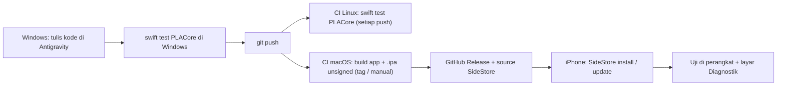
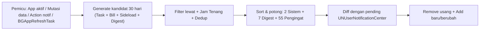
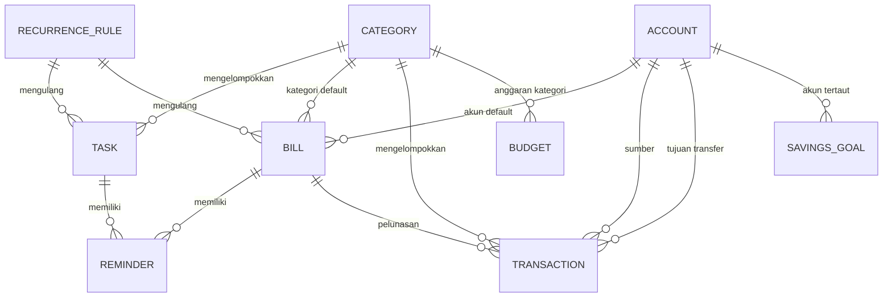
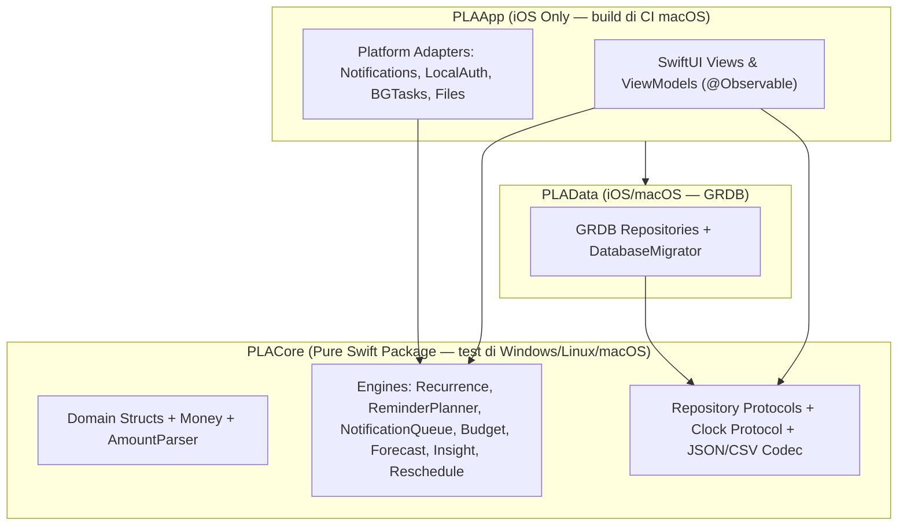

# PRODUCT REQUIREMENTS DOCUMENT (PRD)

# Personal Life Assistant

| Atribut | Nilai |
|---|---|
| Versi | **0.2** (menggantikan v0.1) |
| Tanggal | 26 November 2026 |
| Pemilik | Developer solo (PM + iOS dev) |
| Platform | iOS (iPhone), minimum **iOS 17.0** (lihat ADR-02) |
| Lingkungan dev | Windows + Google Antigravity, tanpa Xcode lokal; build via GitHub Actions macOS |
| Distribusi | SideStore (Apple ID gratis) + Shortcuts auto-refresh; **bukan** App Store/TestFlight |
| Pengguna | Developer sendiri + 3 s.d. 5 teman tester (lihat OQ-04) |
| Prinsip inti | **Minimal Input, Maximum Automation**, offline-first, privasi lokal |
| Status | Draft untuk review |

**Legenda tag**
- `PERLU VERIFIKASI (V-xx)`: klaim yang belum pasti. Cara verifikasi ada di [§21](#21-daftar-perlu-verifikasi).
- `OQ-xx`: pertanyaan terbuka yang harus dijawab pemilik produk, lihat [§20](#20-open-questions).
- **MVP** / **Pasca-MVP** / **Out of Scope**: status setiap fitur, lihat [§7](#7-ruang-lingkup).

---

## Daftar Isi

1. [Ringkasan Produk](#1-ringkasan-produk)
2. [Tujuan & Success Criteria Terukur](#2-tujuan--success-criteria-terukur)
3. [Kondisi Nyata Developer & Batasan](#3-kondisi-nyata-developer--batasan)
4. [Keputusan Teknis Utama (ADR)](#4-keputusan-teknis-utama-adr)
5. [Strategi Build Tanpa Mac](#5-strategi-build-tanpa-mac)
6. [Distribusi SideStore + Shortcuts](#6-distribusi-sidestore--shortcuts)
7. [Ruang Lingkup](#7-ruang-lingkup)
8. [Spesifikasi Fitur MVP: User Story & Acceptance Criteria](#8-spesifikasi-fitur-mvp-user-story--acceptance-criteria)
9. [Sistem Notifikasi](#9-sistem-notifikasi)
10. [Algoritma Lokal (Financial & Personal Intelligence)](#10-algoritma-lokal-financial--personal-intelligence)
11. [Data Model & Migrasi](#11-data-model--migrasi)
12. [Edge Case](#12-edge-case)
13. [Non-Functional Requirements](#13-non-functional-requirements)
14. [Arsitektur Teknis](#14-arsitektur-teknis)
15. [Roadmap](#15-roadmap)
16. [Rencana Testing](#16-rencana-testing)
17. [Risiko & Mitigasi](#17-risiko--mitigasi)
18. [Pasca-MVP](#18-pasca-mvp)
19. [Out of Scope](#19-out-of-scope)
20. [Open Questions](#20-open-questions)
21. [Daftar PERLU VERIFIKASI](#21-daftar-perlu-verifikasi)
22. [Glossary](#22-glossary)
23. [Changelog v0.1 → v0.2](#23-changelog-v01--v02)

---

## 1. Ringkasan Produk

Personal Life Assistant (PLA) adalah asisten pribadi iOS yang menggabungkan **tugas & pengingat**, **tagihan berulang**, dan **keuangan pribadi** dalam satu aplikasi, dengan analisis berbasis aturan yang berjalan sepenuhnya di perangkat.

| Aspek | Penjelasan |
|---|---|
| Masalah | Jadwal, tagihan, dan pengeluaran tercecer di banyak aplikasi; pengingat sering terlambat atau terlupa; pengguna tidak tahu apakah anggaran akan cukup sampai akhir bulan. |
| Solusi | Satu app yang otomatis membuat pengingat dari deadline, mengingatkan tagihan dan langsung mencatatnya saat lunas, serta memproyeksikan pengeluaran sampai akhir periode. |
| Pembeda | Input minimal (≤ 3 tap untuk tugas), semua kecerdasan lokal (rule-based, tanpa AI API), offline penuh, tanpa akun/backend. |
| Bukan | Bukan kalender penuh, bukan aplikasi akuntansi, bukan agregator rekening bank. |

**Prinsip UX** (dipertahankan dari v0.1, dipertajam):

| Prinsip | Aturan konkret |
|---|---|
| Minimal input | Setiap form punya default yang bisa langsung disimpan. Hanya 1 field wajib per entitas (judul tugas / nominal transaksi / nama + nominal tagihan). |
| Smart automation | Pengingat, kategori yang disarankan, akun default, dan pencatatan tagihan lunas dibuat otomatis. |
| Contextual notification | Maks. 1 notifikasi per tugas per hari kecuali prioritas Tinggi; jam tenang default 22.00 s.d. 07.00. |
| Simple navigation | 4 tab: **Beranda, Tugas, Keuangan, Pengaturan**. |
| Clean & konsisten | Satu design system (token warna, tipografi Dynamic Type, spacing 4-pt). |

---

## 2. Tujuan & Success Criteria Terukur

### 2.1 Tujuan produk

| ID | Tujuan (v0.1, dipertahankan) | Diukur oleh |
|---|---|---|
| G1 | Mengingat jadwal, deadline, dan tagihan otomatis | SC-05, SC-06, SC-11 |
| G2 | Mengurangi input manual | SC-01, SC-02, SC-03 |
| G3 | Pengingat kontekstual & tepat waktu | SC-05 |
| G4 | Memahami & mengontrol keuangan | SC-04, SC-16 |
| G5 | Rekomendasi berbasis data & kebiasaan | §10 (rule-based) |
| G6 | Privasi: data diproses lokal | SC-08, NFR keamanan |

### 2.2 Success criteria MVP

| ID | Kriteria | Target | Cara mengukur |
|---|---|---|---|
| SC-01 | Membuat tugas | **≤ 3 tap** dan **≤ 10 detik** (median 5 percobaan), tidak termasuk mengetik judul | Stopwatch pada checklist rilis di perangkat |
| SC-02 | Mencatat pengeluaran | **≤ 4 tap** dan **≤ 10 detik**, tidak termasuk mengetik nominal | Sama dengan SC-01 |
| SC-03 | Menandai tagihan lunas | **≤ 2 tap** dari daftar tagihan atau dari action notifikasi | Checklist rilis |
| SC-04 | Akurasi anggaran, saldo akun, forecast | **100%** lolos unit test, minimal 60 kasus termasuk edge case §12; coverage baris modul `PLACore` ≥ 85% | `swift test` di Windows + CI |
| SC-05 | Ketepatan notifikasi | ≥ **99%** notifikasi terjadwal terkirim dalam **±1 menit** dari jadwal pada soak test 3 hari (≥ 100 notifikasi) | Log diagnostik: `UNNotification.date` dibanding `fireDate` terjadwal (lihat §16) |
| SC-06 | Batas iOS 64 notifikasi | Jumlah pending **≤ 64 setiap saat (100%)**; 0 pengingat dalam horizon yang hilang karena batas | Unit test `NotificationQueuePlanner` + assertion runtime |
| SC-07 | Cold start | **< 2 detik p90** sampai Beranda interaktif, di perangkat referensi (OQ-03) dengan 2.000 transaksi | `os_signpost` + layar Diagnostik |
| SC-08 | Offline | **100%** fitur MVP berfungsi dalam mode pesawat | Checklist rilis |
| SC-09 | Integritas data saat upgrade | **0** kehilangan data saat install versi baru di atas versi lama | Migration test (fixture DB) + uji upgrade di perangkat |
| SC-10 | Stabilitas | 0 crash yang dapat direproduksi berstatus "Tinggi" saat rilis; tester melaporkan ≤ 1 crash/minggu | Laporan tester + crash log perangkat |
| SC-11 | Sideload tidak kedaluwarsa | App developer **tidak pernah expired** selama 4 minggu berturut-turut | Banner masa berlaku di app (F-14) + catatan |
| SC-12 | Pemakaian nyata | Developer memakai app ≥ 5 hari/minggu selama 4 minggu; ≥ 50% tester masih aktif di minggu ke-3 | Self-report + survei tester |
| SC-13 | Aksesibilitas | 100% layar MVP dapat dioperasikan dengan VoiceOver; tidak ada teks terpotong pada Dynamic Type hingga **AX3** | Checklist aksesibilitas di perangkat |
| SC-14 | Ekspor/impor | Ekspor JSON lalu impor ke instalasi bersih menghasilkan data identik (jumlah record & total saldo sama) | Uji round-trip otomatis (Core) + manual |
| SC-15 | Tanpa layanan eksternal | 0 request jaringan dari app pada pemakaian normal | Pemeriksaan kode (tidak ada `URLSession` di MVP) |
| SC-16 | Insight relevan | ≥ 70% insight dinilai "berguna" oleh tester (tombol 👍/👎 di kartu insight) | Hitungan lokal, dikirim manual lewat masukan |

### 2.3 Success criteria Pasca-MVP

| ID | Kriteria | Target |
|---|---|---|
| SC-P1 | Akurasi OCR (Vision) | Pada set uji **50 gambar** dari ≥ 5 aplikasi (bank & e-wallet): nominal benar **≥ 95%**, tanggal **≥ 90%**, merchant **≥ 80%**; waktu proses ≤ 2 detik/gambar |
| SC-P2 | Quick add bahasa natural | ≥ **90%** dari 100 frasa uji Indonesia terparsing benar (tanggal, jam, judul) |
| SC-P3 | Tambah via Siri/Shortcuts | Tugas/transaksi tersimpan tanpa membuka app dalam ≤ 5 detik |

---

## 3. Kondisi Nyata Developer & Batasan

| Kondisi | Konsekuensi di PRD |
|---|---|
| Coding di Windows (Antigravity), tanpa Xcode/Simulator/Preview | Logika bisnis di Swift Package murni yang di-test di Windows (§5.2). UI ditulis tipis, dikompilasi di CI. |
| Akses Mac jarang dan Mac tua | Mac **tidak** ada di jalur kritis. Build & test di GitHub Actions. Mac hanya untuk debug di perangkat, Instruments, cek UI (§5.5). |
| Tidak membayar Apple Developer Program | Tidak ada TestFlight, push notification (APNs), iCloud/CloudKit, dan kemungkinan tidak ada entitlement khusus (Time Sensitive). Semua fitur memakai kemampuan yang tersedia untuk sertifikat gratis. |
| Distribusi SideStore (Apple ID gratis) | Masa berlaku 7 hari, batas app aktif & App ID per minggu. MVP **tanpa app extension** untuk menghemat App ID (§6). |
| Tester: diri sendiri + beberapa teman | Tiap teman sideload dengan Apple ID sendiri. Tidak ada backend, masukan dikirim manual (§16.2). |
| Tanpa layanan berbayar / AI API | Semua kecerdasan rule-based lokal (§10). Satu-satunya dependensi pihak ketiga: GRDB (open source, MIT). |

---

## 4. Keputusan Teknis Utama (ADR)

### ADR-01: Kemampuan Mac tua menentukan apa yang bisa dilakukan lokal

Versi Mac belum diketahui (**OQ-01**). Tabel berikut adalah batas resmi Apple yang dipakai untuk memutuskan. `PERLU VERIFIKASI (V-01)`: cocokkan model Mac via **Menu Apple > About This Mac**.

| Kelompok Mac (perkiraan) | macOS resmi maks. | Xcode maks. | SDK iOS | Bisa compile app target iOS 17? | Bisa debug iPhone iOS 17+? |
|---|---|---|---|---|---|
| MacBook Pro 2018+, Mac mini 2018+, iMac 2019+ (Intel) | Sequoia 15 (beberapa model 2019/2020 sampai Tahoe 26) | Xcode 16.4 (perlu macOS 15.3+); Xcode 26.0 s.d. 26.3 (perlu 15.6+) | iOS 18 / 26 | Ya | Ya |
| MacBook Air 2018/2019 | Sonoma 14 | Xcode 16.2 (16.0 s.d. 16.2 perlu macOS 14.5) | iOS 18.2 | Ya | Ya, untuk iOS terbaru `PERLU VERIFIKASI (V-02)` |
| MacBook Pro 2017, iMac 2017, MacBook 2017 | Ventura 13 | **Xcode 15.2** (15.0 perlu macOS 13.5; 15.3 perlu Sonoma) | iOS 17.2 | Ya (Swift 5.9) | iOS 17 ya; iOS 18/26 `PERLU VERIFIKASI (V-02)` |
| MacBook Pro 2015/2016, MacBook Air 2015 s.d. 2017, iMac 2015, Mac mini 2014 | Monterey 12 | **Xcode 14.2** | iOS 16.2 | **Tidak** (tidak ada SDK iOS 17, SwiftData, `@Observable`) | **Tidak** (iOS 17 memakai mekanisme device baru yang butuh Xcode 15+) |
| Lebih tua (Big Sur ke bawah) | Big Sur 11 atau lebih rendah | Xcode 13.x atau lebih rendah | iOS 15 ke bawah | Tidak | Tidak |

> Catatan: OpenCore Legacy Patcher bisa memasang macOS lebih baru di Mac lama, tetapi tidak resmi dan berisiko. **Tidak** dijadikan rencana; hanya opsi pribadi.

**Kesimpulan ADR-01:** karena build dilakukan di CI (Xcode terbaru di runner macOS), **Mac tua tidak membatasi SDK atau framework yang bisa dipakai app**. Mac hanya membatasi *debugging lokal*. Jika Mac masuk kelompok Monterey atau lebih tua, Mac praktis tidak dipakai, dan PRD tetap jalan (lihat §5.5 jalur tanpa Mac).

### ADR-02: Minimum deployment target = iOS 17.0

| Alasan | Detail |
|---|---|
| Observation framework | `@Observable` (iOS 17) membuat state SwiftUI lebih sederhana dan lebih mudah ditulis tanpa Preview. |
| Cakupan perangkat | iOS 17 mendukung iPhone XS/XR ke atas. |
| Konsekuensi | Teman dengan iPhone 8/X (maks. iOS 16) tidak bisa ikut. **OQ-03** mengonfirmasi perangkat tester; jika ada iOS 16, turunkan ke iOS 16 dan pakai `ObservableObject`. |

### ADR-03: Persistensi = **GRDB (SQLite)**, SwiftData **tidak** dipakai di MVP

| Opsi | Kelebihan | Kekurangan untuk kondisi developer ini | Keputusan |
|---|---|---|---|
| **SwiftData** | Native, sedikit kode, terintegrasi SwiftUI | Butuh iOS 17 + Xcode 15 (CI aman, Mac tua mungkin tidak). Bug & perilaku migrasi di iOS 17.x sulit didiagnosis tanpa debugger. Migrasi skema (`VersionedSchema`) kurang transparan. Model via macro: error kompilasi baru terlihat di CI. Risiko kehilangan data keuangan saat migrasi gagal tidak bisa di-debug di perangkat. | Ditolak untuk MVP |
| **Core Data** | Native, matang, iOS lama | Model `.xcdatamodeld` praktis harus diedit di Xcode (XML manual rawan salah dari Windows). Kode verbose. | Ditolak |
| **GRDB** | Skema & migrasi ditulis sebagai kode Swift biasa (bisa diedit penuh dari Windows), migrasi eksplisit & berurutan, SQL bisa diinspeksi, file `.sqlite` mudah di-backup/ekspor, observasi data untuk SwiftUI tersedia, tidak bergantung pada versi Xcode tertentu | Dependensi pihak ketiga (MIT, gratis); perlu menulis SQL/record sendiri | **Dipilih** |

Aturan pelaksanaan:
- Semua akses data lewat **protokol Repository** yang didefinisikan di `PLACore`. Implementasi GRDB ada di modul `PLAData`. Mengganti ke SwiftData kelak hanya mengganti `PLAData`.
- Versi GRDB dipin sesuai Xcode CI. `PERLU VERIFIKASI (V-15)`: kebutuhan versi Swift/Xcode GRDB 7.x vs 6.x. Jika Mac hanya bisa Xcode 15, pin GRDB 6.x agar proyek tetap bisa di-build lokal.
- Uang disimpan sebagai **`Int64` rupiah utuh** (tanpa desimal, tanpa `Double`).

### ADR-04: Kompatibilitas bahasa Swift

| Keputusan | Alasan |
|---|---|
| `PLACore` memakai `swift-tools-version: 5.9` dan menghindari fitur khusus Swift 6.x | Tetap bisa dikompilasi oleh Xcode 15 (Mac kelompok Ventura) sekaligus toolchain Windows terbaru. |
| Framework test `PLACore` = **XCTest** | XCTest tersedia di Windows, Linux, dan Xcode 15+. Swift Testing butuh toolchain Swift 6 (tidak ada di Xcode 15). |
| Toolchain Windows dipin ke versi Swift yang sama (major.minor) dengan Xcode di CI | Mengurangi beda perilaku compiler. `PERLU VERIFIKASI (V-13)`. |

---

## 5. Strategi Build Tanpa Mac

### 5.1 Alur kerja harian



### 5.2 Pemisahan kode agar bisa di-test di Windows

| Modul | Isi | Boleh import | Dites di |
|---|---|---|---|
| `PLACore` (Swift Package) | Model domain (struct), `Money`, `AmountParser`, `RecurrenceEngine`, `ReminderPlanner`, `NotificationQueuePlanner`, `BudgetCalculator`, `Forecaster`, `InsightEngine`, `RescheduleSuggester`, encoder/decoder ekspor JSON/CSV, protokol Repository, protokol `Clock` | **Hanya** Swift stdlib + Foundation lintas platform. **Dilarang**: UIKit, SwiftUI, UserNotifications, Vision, LocalAuthentication, GRDB | Windows (lokal), Linux CI, macOS CI |
| `PLAData` | Implementasi Repository dengan GRDB, migrasi | GRDB, PLACore | macOS CI (simulator) saat tag |
| `PLAApp` | SwiftUI views, view model, adapter platform (Notifications, LocalAuth, BackgroundTasks, Files) | Semua | Uji di perangkat |

Aturan agar hasil konsisten lintas platform:
- Semua fungsi yang bergantung waktu menerima `now: Date`, `calendar: Calendar`, `timeZone: TimeZone` sebagai parameter (lewat protokol `Clock`). Tidak ada `Date()` langsung di `PLACore`.
- `PLACore` tidak memformat teks (Rupiah, tanggal Indonesia). Formatting ada di `PLAApp`, karena data locale/ICU di Windows bisa berbeda dengan iOS.
- Test `PLACore` juga dijalankan di macOS CI untuk mendeteksi perbedaan Foundation Windows vs Darwin. `PERLU VERIFIKASI (V-13)`.

### 5.3 Pipeline CI (GitHub Actions)

| Workflow | Pemicu | Runner | Langkah |
|---|---|---|---|
| `core-tests.yml` | Setiap push & PR | `ubuntu-latest` (image Docker `swift`) | `swift build` + `swift test` di `Packages/PLACore`; laporan coverage |
| `ios-build.yml` | Tag `v*`, `workflow_dispatch` (dan PR ke `main` bila repo publik) | `macos-15` atau `macos-26` | 1) pilih Xcode; 2) `brew install xcodegen` lalu `xcodegen generate` dari `project.yml`; 3) `swift test` PLACore (paritas); 4) test `PLAData` di simulator (hanya tag); 5) `xcodebuild archive ... CODE_SIGNING_ALLOWED=NO`; 6) bungkus `Payload/PLA.app` jadi `.ipa`; 7) unggah artifact + GitHub Release; 8) perbarui `apps.json` (source SideStore) |

Detail penting:
- **Tidak ada `.xcodeproj` di repo.** Proyek dibuat dari `project.yml` (XcodeGen) di CI, sehingga semua konfigurasi bisa diedit sebagai teks dari Windows.
- **IPA unsigned:** SideStore menandatangani ulang dengan sertifikat Apple ID pengguna. `PERLU VERIFIKASI (V-05)`: apakah build `CODE_SIGNING_ALLOWED=NO` tetap membawa entitlements yang diperlukan. Alternatif: ad-hoc sign `CODE_SIGN_IDENTITY="-"` atau `ldid`. MVP tidak butuh entitlement khusus, jadi risiko rendah.
- Nomor build = `github.run_number`; versi = tag (`v0.3.0`).
- Cache SPM (`SourcePackages`) untuk memangkas waktu build.
- Image runner berubah dari waktu ke waktu (macOS 14 sudah dipensiunkan). `PERLU VERIFIKASI (V-04)`: daftar image & versi Xcode default di repo `actions/runner-images` sebelum menulis workflow.

### 5.4 Kuota menit GitHub Actions

| Jenis repo | Runner standar | Kuota (paket GitHub Free) | Dampak untuk proyek ini |
|---|---|---|---|
| **Publik** | Gratis, tidak dibatasi menit | Tidak berlaku | Build macOS di setiap PR aman |
| **Privat** | Memotong kuota bulanan | **2.000 menit/bulan**; menit macOS dihitung **10×** (Linux 1×) | Setara **±200 menit macOS/bulan** jika tidak ada job lain, kira-kira 13 s.d. 20 build (estimasi 10 s.d. 15 menit/build) |

`PERLU VERIFIKASI (V-03)`: angka kuota & pengali di halaman *GitHub Actions billing* (harga GitHub berubah di 2026) dan durasi build nyata setelah run pertama.

**Rekomendasi (OQ-02):**
1. **Repo publik** jika tidak ada data pribadi di repo: menit tak terbatas, URL rilis bisa langsung dipakai teman.
2. Jika harus privat: build macOS **hanya** saat tag/manual, test Core di Linux setiap push, dan publikasikan `.ipa` + `apps.json` ke repo publik terpisah (`pla-releases`) memakai token terbatas.

### 5.5 Peran Mac yang jarang

| Jika Mac bisa Xcode ≥ 15 (kelompok Ventura ke atas) | Jika Mac hanya Xcode ≤ 14 (Monterey ke bawah) |
|---|---|
| Debug di iPhone dengan breakpoint | Mac tidak dipakai |
| Instruments: App Launch, Time Profiler, Allocations, Leaks | Ukur cold start lewat `os_signpost` + layar Diagnostik di app |
| Accessibility Inspector | Uji VoiceOver & Dynamic Type langsung di iPhone (tidak butuh Mac) |
| View hierarchy debugger, Console.app streaming log | Log perangkat dari Windows via `idevicesyslog` (libimobiledevice) `PERLU VERIFIKASI (V-21)` + ekspor log dari layar Diagnostik |

**Checklist sesi Mac** (dibawa setiap kali dapat akses, maks. 2 jam):
1. Install build tag terakhir via Xcode (bukan SideStore) di perangkat.
2. App Launch trace (cold start) 3×, simpan angka.
3. Time Profiler saat scroll daftar 5.000 transaksi.
4. Allocations/Leaks setelah 10 menit pemakaian.
5. Accessibility Inspector audit di 4 tab utama.
6. Catat temuan sebagai issue dengan label `mac-session`.

---

## 6. Distribusi SideStore + Shortcuts

> Semua batasan di bagian ini berasal dari dokumentasi komunitas SideStore/AltStore dan dapat berubah sewaktu-waktu oleh Apple atau SideStore. Setiap klaim diberi status.

### 6.1 Batasan Apple ID gratis

| Batasan | Nilai yang diketahui | Dampak untuk PLA | Status |
|---|---|---|---|
| Masa berlaku sertifikat/profil | **7 hari**, harus di-refresh | App tidak bisa dibuka setelah expired sampai di-refresh; data tetap ada | Umum diketahui; perilaku notifikasi terjadwal saat app expired `PERLU VERIFIKASI (V-22)` |
| App aktif per perangkat | **3 app**, SideStore memakai 1 slot | Sisa 2 slot: PLA + 1 app lain | `PERLU VERIFIKASI (V-06)` |
| App ID baru | **10 per 7 hari (bergulir)** | PLA = 1 App ID; setiap extension (Share, Widget) +1 App ID | `PERLU VERIFIKASI (V-06)`: apakah refresh memakai ulang App ID yang sama, dan apakah extension dihitung dalam batas 3 app aktif |
| Bundle ID diubah SideStore | SideStore/AltStore biasanya menambahkan suffix Team ID ke bundle ID | Ganti Apple ID = bundle ID berbeda = **container data berbeda (data lama tidak terbaca)** | `PERLU VERIFIKASI (V-09)` |
| App Groups (berbagi data app ↔ extension) | Laporan komunitas campur: kadang gagal di akun gratis | Share Extension & Widget bergantung pada App Group, jadi **tidak masuk MVP** | `PERLU VERIFIKASI (V-07)` |
| Entitlement khusus (Time Sensitive notification, iCloud, Push) | iCloud & Push tidak tersedia untuk akun gratis; Time Sensitive belum jelas | Notifikasi memakai level standar (§9.5) | `PERLU VERIFIKASI (V-10)` |
| Developer Mode | Wajib aktif di iOS 16+ untuk app bertanda tangan development | Langkah setup tambahan untuk tester | Umum diketahui |

**Keputusan:** MVP = **1 App ID, tanpa extension.** Kebutuhan "tambah tanpa membuka app" dan "tangkap struk" dipenuhi lewat **App Intents di dalam app utama** (tidak butuh extension maupun App Group) pada Pasca-MVP.

### 6.2 Setup awal (developer & teman), dari PC Windows

| # | Langkah | Di mana | Catatan |
|---|---|---|---|
| 1 | Install **iTunes** versi dari situs Apple (bukan Microsoft Store) | PC Windows | Menyediakan driver perangkat. `PERLU VERIFIKASI (V-18)` |
| 2 | Install **iloader** (installer SideStore) | PC Windows | `PERLU VERIFIKASI (V-18)`: nama & versi tool terbaru di sidestore.io |
| 3 | Install **LocalDevVPN** dari App Store | iPhone | VPN loopback yang dipakai SideStore untuk refresh tanpa PC |
| 4 | Sambungkan iPhone via USB, buka kunci, tap **Trust** | PC + iPhone | |
| 5 | Di iloader: login Apple ID → install SideStore → iloader membuat & menaruh **pairing file** | PC | Pairing file = bukti kepercayaan PC–iPhone; disimpan oleh SideStore |
| 6 | Aktifkan **Developer Mode** (Settings > Privacy & Security), restart | iPhone | |
| 7 | Trust profil developer (Settings > General > VPN & Device Management) | iPhone | |
| 8 | Nyalakan LocalDevVPN → buka SideStore → login Apple ID yang sama → refresh SideStore | iPhone | |
| 9 | Tambah PLA: via **source** (`apps.json`) atau file `.ipa` dari Files | iPhone | Lihat §6.4 |
| 10 | Pasang **Shortcuts Automation** auto-refresh | iPhone | Lihat §6.3 |

Pairing file bisa hilang/invalid (misalnya setelah reset perangkat atau update iOS tertentu); perbaikan = ulangi langkah 4 s.d. 5 di PC (iloader: hapus pairing tersimpan, buat ulang, taruh ke SideStore). `PERLU VERIFIKASI (V-19)`: kondisi apa saja yang membuat pairing invalid.

### 6.3 Auto-refresh via Shortcuts Automation

| Komponen | Isi |
|---|---|
| Pemicu | **Time of Day**, setiap hari 03.00 (saat biasanya terhubung Wi-Fi & dicas). Cadangan: pemicu **Wi-Fi rumah tersambung**. |
| Pengaturan | Aktifkan **"Run Immediately"** (atau matikan **"Ask Before Running"** di versi iOS lama); matikan **"Notify When Run"** |
| Aksi shortcut | 1) Hubungkan LocalDevVPN (aksi Shortcuts dari LocalDevVPN, jika tersedia); 2) Tunggu 5 detik; 3) jalankan aksi **Refresh All Apps** dari SideStore (atau buka SideStore); 4) Tunggu 15 s.d. 30 detik; 5) putuskan VPN (opsional) |
| Frekuensi | Harian, agar ada 6 kali kesempatan sebelum batas 7 hari |
| Status | `PERLU VERIFIKASI (V-08)`: ketersediaan aksi Shortcuts SideStore & LocalDevVPN di versi terbaru, dan apakah berjalan saat layar terkunci |

**Pengaman di dalam PLA (F-14):**
- App membaca tanggal kedaluwarsa dari `embedded.mobileprovision` di bundle. `PERLU VERIFIKASI (V-16)`.
- Pengaturan menampilkan "Berlaku sampai Rabu, 2 Des 2026 (5 hari lagi)".
- Notifikasi lokal **H-2 dan H-1** sebelum expired: "Buka SideStore untuk memperpanjang PLA". Notifikasi ini memakai slot sistem di antrean (§9.2).
- Banner di Beranda bila sisa ≤ 2 hari.

### 6.4 Cara teman meng-install

| Opsi | Cara | Kelebihan | Kekurangan |
|---|---|---|---|
| **A. Source SideStore (disarankan)** | Developer meng-host `apps.json` (format source AltStore/SideStore) di GitHub Pages; teman menambahkan URL source di SideStore | Teman mendapat notifikasi update di SideStore | Butuh URL publik. `PERLU VERIFIKASI (V-20)`: format source terbaru |
| B. File `.ipa` | Unduh `.ipa` dari GitHub Release → Files → SideStore "+" | Paling sederhana | Update manual |

Aturan untuk teman:
- Memakai **Apple ID sendiri** (boleh Apple ID sekunder untuk privasi). Jangan berbagi Apple ID.
- Butuh akses PC (Windows/Mac/Linux) **sekali** untuk setup awal & pairing; developer bisa membantu memakai PC-nya.
- Sebelum ganti Apple ID atau menghapus app: **wajib ekspor backup** (F-13), karena data bisa tidak terbaca (V-09).
- Panduan setup 1 halaman (`docs/INSTALL_TESTER.md`) dengan screenshot dibuat di Fase 0.

---

## 7. Ruang Lingkup

### 7.1 Matriks fitur

| ID | Fitur | Status | Fase |
|---|---|---|---|
| F-01 | Dashboard (Beranda) | **MVP** | 1, 4 |
| F-02 | Tugas: buat cepat & kelola | **MVP** | 2 |
| F-03 | Smart Reminder otomatis (pola H-n per prioritas) | **MVP** | 2 |
| F-04 | Tugas berulang (Recurring) | **MVP** | 2 |
| F-05 | Notifikasi lokal: antrean rolling, suara kustom, izin, ringkasan pagi | **MVP** | 2 |
| F-06 | Reschedule cepat + saran hari pengganti dasar | **MVP** | 2 |
| F-07 | Akun/Dompet (Cash, Bank, E-wallet) + transfer | **MVP** | 3 |
| F-08 | Transaksi pemasukan/pengeluaran + kategori + saran kategori | **MVP** | 3 |
| F-09 | Anggaran bulanan (total + per kategori opsional) | **MVP** | 3 |
| F-10 | Tagihan & Langganan berulang | **MVP** | 4 |
| F-11 | Ringkasan keuangan + analisis pengeluaran dasar (forecast, batas aman harian, peringatan, kategori terbesar, saran hemat) | **MVP** | 4 |
| F-12 | Kunci Face ID untuk Keuangan (fallback passcode) | **MVP** | 3 |
| F-13 | Backup/restore & ekspor JSON/CSV via Files | **MVP** | 4 |
| F-14 | Diagnostik, masa berlaku sideload, kirim masukan | **MVP** | 0 s.d. 4 |
| F-15 | Onboarding singkat & Pengaturan | **MVP** | 1, 4 |
| P-01 | Quick add bahasa natural ("rapat besok jam 3") | Pasca-MVP | 5 |
| P-02 | App Intents / Siri Shortcuts: tambah tugas & transaksi | Pasca-MVP | 5 |
| P-03 | Target tabungan (Savings Goal) | Pasca-MVP | 5 |
| P-04 | Simulasi "bagaimana jika" keuangan | Pasca-MVP | 5 |
| P-05 | OCR struk/bukti transfer (Vision) via App Intent + Shortcuts | Pasca-MVP | 6 |
| P-06 | Share Extension (bersyarat V-06, V-07) | Pasca-MVP | 6 |
| P-07 | Widget (bersyarat V-07) | Pasca-MVP | 7 |
| P-08 | Smart Rescheduling lanjutan (beban harian, kalender EventKit) | Pasca-MVP | 7 |
| P-09 | Personal Intelligence (keterlambatan, jam produktif, penyesuaian offset) | Pasca-MVP | 7 |
| P-10 | Tugas berulang "dari tanggal selesai" | Pasca-MVP | 7 |
| P-11 | Peringatan akhir masa trial langganan | Pasca-MVP | 7 |
| X-xx | Lihat [§19 Out of Scope](#19-out-of-scope) | Out of Scope | - |

### 7.2 Navigasi MVP

| Tab | Isi |
|---|---|
| Beranda | Hari ini, Terlambat, Tagihan 7 hari, Ringkasan keuangan (bisa disamarkan), Insight (maks. 3), tombol tambah cepat |
| Tugas | Segmen: Hari ini / Mendatang / Kapan saja / Selesai |
| Keuangan (terkunci Face ID) | Segmen: Ringkasan / Transaksi / Tagihan / Akun / Anggaran |
| Pengaturan | Pengingat & suara, jam tenang, periode anggaran, keamanan, backup/ekspor, Diagnostik, Kirim masukan, Tentang (versi, masa berlaku) |


---

## 8. Spesifikasi Fitur MVP: User Story & Acceptance Criteria

Setiap fitur MVP di bawah wajib lulus seluruh Acceptance Criteria (`Given / When / Then`) sebelum MVP dinyatakan selesai.

### F-01: Dashboard (Beranda)

> **User Story:** Sebagai pengguna, saya ingin melihat ringkasan tugas hari ini, tugas terlambat, tagihan dekat jatuh tempo, kondisi anggaran, dan insight penting dalam satu layar, agar saya langsung tahu prioritas hari ini tanpa berpindah-pindah menu.

| AC | Given | When | Then |
|---|---|---|---|
| AC-01.1 | Ada tugas hari ini, tugas terlambat, tagihan ≤ 7 hari, dan anggaran aktif | Pengguna membuka app | Beranda tampil < 2 detik dengan urutan blok: Banner peringatan (jika ada), Terlambat, Hari Ini, Tagihan 7 Hari, Ringkasan Keuangan, dan maks. 3 Kartu Insight. |
| AC-01.2 | Kunci Face ID Keuangan aktif dan sesi keuangan masih terkunci | Pengguna berada di Beranda | Nominal rupiah di kartu Ringkasan Keuangan disamarkan (`Rp••••••`); tersedia tombol "Buka" untuk autentikasi; status teks (mis. "Waspada") tetap boleh tampil jika disetel di Pengaturan. |
| AC-01.3 | Pengguna baru tanpa tugas, tagihan, dan transaksi | Pengguna membuka Beranda | Tidak ada angka `NaN`/kosong membingungkan; muncul kartu panduan awal dengan tombol cepat "Buat Tugas Pertama" dan "Catat Transaksi". |
| AC-01.4 | Pengguna menekan tombol tambah cepat (`+`) di Beranda | Menu pilih cepat muncul | Pengguna dapat memilih "Tugas", "Pengeluaran", "Pemasukan", atau "Transfer" dalam 1 tap tambahan. |

### F-02: Tugas (Buat Cepat & Kelola)

> **User Story:** Sebagai pengguna, saya ingin menambah, menyunting, menyelesaikan, dan menghapus tugas dengan input seminimal mungkin, agar saya tidak malas mencatat rencana.

| AC | Given | When | Then |
|---|---|---|---|
| AC-02.1 | Pengguna di tab Beranda atau Tugas | Pengguna tap `+` → ketik judul → tap "Simpan" (≤ 3 tap di luar mengetik) | Tugas tersimpan dengan default: prioritas `Sedang`, kategori `Umum`, tanpa deadline (masuk segmen "Kapan saja"). |
| AC-02.2 | Form tambah tugas terbuka | Pengguna mengetuk chip cepat deadline ("Hari ini", "Besok", "Akhir pekan", atau pilih tanggal/jam) lalu Simpan | Tugas masuk daftar sesuai tanggal dan Smart Reminder otomatis dibuat (F-03). |
| AC-02.3 | Ada tugas aktif di daftar | Pengguna mengetuk lingkaran centang pada tugas | Status menjadi `Selesai`, `completedAt` terekam, semua notifikasi terjadwal tugas itu dibatalkan, dan muncul toast "Selesai" dengan tombol **Urungkan (5 detik)**. |
| AC-02.4 | Judul tugas kosong atau hanya spasi | Pengguna mencoba menyimpan | Tombol Simpan nonaktif dan muncul pesan validasi singkat; data tidak tersimpan. |
| AC-02.5 | Pengguna menyunting deadline atau menghapus tugas | Perubahan disimpan / dikonfirmasi | Pengingat lama dibersihkan dan antrean notifikasi di-sinkronkan ulang seketika. |

### F-03: Smart Reminder Otomatis

> **User Story:** Sebagai pengguna, saya ingin sistem otomatis membuat jadwal pengingat berdasarkan jarak deadline dan prioritas tugas, agar saya tidak perlu mengatur pengingat satu per satu.

| AC | Given | When | Then |
|---|---|---|---|
| AC-03.1 | Pengguna membuat tugas prioritas `Tinggi` dengan deadline 10 hari lagi | Tugas disimpan tanpa kustomisasi reminder | Sistem otomatis membuat pengingat pada **H-7, H-3, H-1, Hari H (pagi), dan 2 jam sebelum deadline** (sesuai pola §9.4). |
| AC-03.2 | Pengguna membuat tugas dengan deadline 2 hari lagi | Smart Reminder dijalankan | Offset yang jatuh di masa lalu (H-7, H-3) **tidak** dibuat; hanya offset yang masih di masa depan yang dijadwalkan. |
| AC-03.3 | Dua pengingat dari tugas yang sama jatuh di tanggal dan jam yang sama (karena deadline dekat) | Sistem menghitung daftar pengingat | Keduanya digabung menjadi 1 pengingat dengan prioritas tertinggi. |
| AC-03.4 | Pengguna mengubah pola default Smart Reminder di Pengaturan (mis. mematikan H-7) | Pengguna membuat tugas baru setelahnya | Tugas baru mengikuti pola yang sudah diubah; tugas lama tidak berubah kecuali diedit. |

### F-04: Tugas Berulang (Recurring)

> **User Story:** Sebagai pengguna, saya ingin membuat tugas berulang harian, mingguan, bulanan, atau tahunan, agar jadwal rutin tidak perlu diinput ulang setiap periode.

| AC | Given | When | Then |
|---|---|---|---|
| AC-04.1 | Pengguna membuat tugas dengan aturan berulang (Harian / Mingguan pilih hari / Bulanan tgl N atau akhir bulan / Tahunan) | Tugas disimpan | Tugas tampil pada jadwal berikutnya beserta ikon berulang dan Smart Reminder untuk siklus aktif. |
| AC-04.2 | Tugas berulang siklus saat ini ditandai selesai | Pengguna mencentang selesai | Siklus saat ini tercatat selesai di riwayat, dan sistem otomatis membuat siklus berikutnya sesuai `RecurrenceRule` lengkap dengan pengingatnya. |
| AC-04.3 | Tugas berulang bulanan dibuat dengan anchor tanggal `31` | Siklus Januari selesai | Siklus Februari dijadwalkan ke 28 Feb (29 Feb di tahun kabisat), dan siklus Maret kembali ke **31 Maret** (lihat §12). |
| AC-04.4 | Pengguna menghapus tugas berulang | Dialog konfirmasi muncul | Pengguna memilih "Hapus siklus ini saja" (lanjut ke siklus berikutnya) atau "Hapus seluruh seri berulang". |

### F-05: Notifikasi Lokal (Rolling Queue, Suara, Ringkasan Pagi)

> **User Story:** Sebagai pengguna, saya ingin menerima notifikasi pengingat tepat waktu dengan suara berbeda sesuai urgensi dan ringkasan pagi, agar saya langsung peka tanpa harus membuka ponsel.

| AC | Given | When | Then |
|---|---|---|---|
| AC-05.1 | Pengguna memiliki > 64 pengingat mendatang dalam 30 hari | Antrean notifikasi disinkronkan | Jumlah pending di `UNUserNotificationCenter` **≤ 64**; 55 slot diisi pengingat terdekat berdasarkan waktu & prioritas (§9.2). |
| AC-05.2 | Notifikasi tugas prioritas `Tinggi` atau `Tagihan` terkirim saat app tertutup | Ponsel tidak dalam mode senyap/Focus blokir | Notifikasi berbunyi menggunakan file audio kustom sesuai jenis (`pla_urgent.caf` / `pla_bill.caf`, durasi ≤ 30 detik). |
| AC-05.3 | Notifikasi muncul di layar kunci | Pengguna menahan notifikasi (long press) | Tersedia aksi cepat **"Tandai Selesai"** dan **"Tunda 1 Jam"** (atau **"Tandai Lunas"** untuk tagihan) yang bekerja tanpa membuka UI penuh. |
| AC-05.4 | Pengguna menolak izin notifikasi iOS | Pengguna membuka tab Tugas atau Pengaturan | Muncul banner non-intrusif "Notifikasi nonaktif" dengan tombol pintas ke Settings iOS; app tidak crash dan jadwal tetap tersimpan. |
| AC-05.5 | Ringkasan pagi aktif (default 07.30) dan ada ≥ 1 tugas/tagihan hari itu | Jam 07.30 tiba | Terkirim 1 notifikasi ringkas: "Hari ini: X tugas, Y tagihan jatuh tempo". Jika kosong, tidak mengirim notifikasi. |

### F-06: Reschedule Cepat & Saran Dasar

> **User Story:** Sebagai pengguna, saya ingin menunda atau menjadwalkan ulang tugas yang terlewat dengan satu ketukan berdasarkan saran hari yang paling longgar, agar daftar tugas tetap realistis.

| AC | Given | When | Then |
|---|---|---|---|
| AC-06.1 | Ada tugas melewati deadline (`dueDate < sekarang`, belum selesai) | Pengguna membuka Beranda atau tab Tugas | Tugas tampil pada bagian "Terlambat" dengan tombol **"Jadwalkan Ulang"**. |
| AC-06.2 | Pengguna menekan "Jadwalkan Ulang" pada sebuah tugas | Sheet reschedule terbuka | Sistem menampilkan opsi cepat ("Hari ini", "Besok", "Akhir pekan", "Pilih tanggal") ditambah **1 saran hari terbaik** dalam 7 hari ke depan (hari dengan jumlah tugas aktif paling sedikit, beserta jumlah tugas hari itu). |
| AC-06.3 | Saran hari tampil di sheet | Pengguna belum menekan konfirmasi | Sistem **tidak** mengubah jadwal secara otomatis; jadwal hanya berubah setelah pengguna memilih dan menekan konfirmasi. |
| AC-06.4 | Pengguna mengonfirmasi tanggal baru | Data disimpan | `dueDate` diperbarui, status tidak lagi terlambat, dan Smart Reminder dihitung ulang. |

### F-07: Akun / Dompet Sederhana & Transfer

> **User Story:** Sebagai pengguna, saya ingin memisahkan saldo Tunai, Bank, dan E-wallet serta mencatat transfer antar akun, agar saya tahu posisi uang saya yang sebenarnya tanpa merusak laporan pengeluaran.

| AC | Given | When | Then |
|---|---|---|---|
| AC-07.1 | Pengguna di tab Keuangan > Akun | Pengguna menambah akun (Nama, Tipe: `Cash` / `Bank` / `E-wallet`, Saldo awal ≥ 0) | Akun tampil dengan saldo awal; total kekayaan cair (semua akun aktif) diperbarui otomatis. |
| AC-07.2 | Ada transaksi pengeluaran Rp50.000 pada akun GoPay (saldo awal Rp200.000) | Transaksi disimpan | Saldo GoPay langsung menjadi Rp150.000; jika transaksi dihapus atau nominal diubah, saldo ikut terkoreksi akurat. |
| AC-07.3 | Pengguna melakukan Transfer Rp500.000 dari `BCA` ke `GoPay` (dengan biaya admin opsional Rp2.500) | Transfer disimpan | Saldo `BCA` berkurang Rp502.500, saldo `GoPay` bertambah Rp500.000; **Rp500.000 tidak dihitung sebagai pengeluaran/pemasukan maupun anggaran**, sedangkan biaya admin Rp2.500 (jika diisi) tercatat sebagai pengeluaran kategori "Biaya Admin". |
| AC-07.4 | Pengguna mencoba transfer dari akun A ke akun A yang sama | Pengguna memilih akun tujuan | Opsi akun asal disembunyikan atau tombol Simpan dinonaktifkan dengan pesan "Pilih akun tujuan yang berbeda". |
| AC-07.5 | Pengguna ingin menghapus akun yang sudah punya transaksi | Pengguna memilih hapus | Sistem menawarkan **Arsipkan Akun** (hilang dari pilihan transaksi baru, riwayat tetap utuh), bukan penghapusan permanen yang merusak histori. |

### F-08: Transaksi Pemasukan & Pengeluaran

> **User Story:** Sebagai pengguna, saya ingin mencatat pemasukan atau pengeluaran dalam hitungan detik dengan kategori dan akun yang sudah terisi cerdas, agar pencatatan rutin terasa ringan.

| AC | Given | When | Then |
|---|---|---|---|
| AC-08.1 | Pengguna di Beranda atau tab Keuangan | Tap `+` → masukkan nominal → pilih kategori → tap "Simpan" (≤ 4 tap di luar ketik) | Transaksi tersimpan dengan akun default (akun terakhir dipakai/utama) dan tanggal hari ini; saldo akun dan sisa anggaran langsung terbarui. |
| AC-08.2 | Pengguna sudah pernah mencatat ≥ 2 kali transaksi dengan catatan "Kopi" berkategori `Makan & Minum` | Pengguna mengetik "Kopi susu" di catatan | Chip saran kategori `Makan & Minum` muncul untuk dipilih 1 tap. |
| AC-08.3 | Pengguna memasukkan nominal `0`, negatif, teks non-angka, atau > `999.999.999.999` | Pengguna mencoba simpan | Tombol Simpan nonaktif dengan pesan error jelas (§12). |
| AC-08.4 | Pengguna membuka daftar Transaksi | Pengguna memfilter berdasarkan tipe (Semua/Pengeluaran/Pemasukan/Transfer), akun, kategori, atau pencarian kata | Daftar diperbarui instan beserta subtotal hasil filter. |

### F-09: Anggaran Bulanan

> **User Story:** Sebagai pengguna, saya ingin menetapkan batas anggaran bulanan total dan per kategori penting, agar saya bisa melihat sisa ruang belanja kapan saja.

| AC | Given | When | Then |
|---|---|---|---|
| AC-09.1 | Pengguna membuka Keuangan > Anggaran | Pengguna menetapkan anggaran total bulanan (mis. Rp3.000.000) dan opsional batas per kategori (mis. Makan Rp1.000.000) | Progress bar tampil dengan angka terpakai, sisa, persentase, dan label status (`Aman` < 75%, `Waspada` 75%–99%, `Melebihi` ≥ 100%). |
| AC-09.2 | Pengguna mencatat transfer antar akun Rp1.000.000 | Daftar anggaran dilihat kembali | Realisasi anggaran **tidak** bertambah oleh nominal transfer. |
| AC-09.3 | Pengguna mengganti tanggal mulai siklus bulanan di Pengaturan (mis. tanggal 25 mengikuti gajian) | Perubahan disimpan | Semua hitungan periode aktif, sisa hari, dan forecast langsung memakai rentang 25 bulan lalu s.d. 24 bulan ini. |

### F-10: Tagihan & Langganan Berulang

> **User Story:** Sebagai pengguna, saya ingin melacak tagihan dan langganan rutin beserta pengingat jatuh temponya, lalu menandainya lunas dalam 2 tap agar otomatis masuk pencatatan pengeluaran.

| AC | Given | When | Then |
|---|---|---|---|
| AC-10.1 | Pengguna membuka Keuangan > Tagihan | Pengguna menambah tagihan (Nama, Nominal/Estimasi, Jatuh tempo, Siklus: Bulanan/Tahunan/Mingguan, Akun & Kategori default) | Tagihan masuk daftar "Akan Datang" dan pengingat otomatis (H-3, H-1, Hari H) masuk ke antrean notifikasi. |
| AC-10.2 | Tagihan "Internet Rp350.000" berstatus belum lunas | Pengguna tap **"Tandai Lunas"** → konfirmasi (≤ 2 tap; bisa ubah nominal aktual jika tagihan variabel seperti listrik) | 1) Terbuat 1 `Transaction` pengeluaran tertaut ke `billId`; 2) Saldo akun default berkurang; 3) Realisasi anggaran bertambah; 4) Tanggal jatuh tempo tagihan maju ke siklus berikutnya + pengingat siklus baru dijadwalkan. |
| AC-10.3 | Pengguna memilih **"Lewati Siklus Ini"** pada tagihan | Pengguna mengonfirmasi | Tidak ada transaksi dibuat; jatuh tempo maju ke siklus berikutnya dan pengingat siklus saat ini dibatalkan. |
| AC-10.4 | Tagihan sudah melewati tanggal jatuh tempo dan belum lunas | Pengguna membuka Beranda atau Tagihan | Tagihan diberi label **"Jatuh Tempo Terlewat"** dengan indikator ikon + teks (bukan warna saja). |

### F-11: Ringkasan Keuangan & Analisis Pengeluaran Dasar

> **User Story:** Sebagai pengguna, saya ingin melihat proyeksi pengeluaran akhir bulan, batas aman belanja per hari, kategori terbesar, dan peringatan dini jika pengeluaran terlalu cepat, agar saya bisa mengerem sebelum uang habis.

| AC | Given | When | Then |
|---|---|---|---|
| AC-11.1 | Pengguna memiliki anggaran aktif dan transaksi dalam periode | Pengguna membuka Keuangan > Ringkasan | Tampil: Total Pemasukan, Total Pengeluaran, Arus Kas Bersih, Sisa Anggaran, Batas Aman Harian, Proyeksi Akhir Bulan (bila syarat cold start terpenuhi), dan Top 3 Kategori Pengeluaran. |
| AC-11.2 | Pengeluaran memenuhi pemicu §10.1 (mis. ≥ 85% anggaran terpakai atau proyeksi > 110%) | Sistem mengevaluasi aturan lokal | Kartu peringatan tampil di Beranda dan Ringkasan Keuangan berisi angka spesifik dan saran penyesuaian harian; semua perhitungan cocok 100% dengan rumus §10.1. |
| AC-11.3 | Hari berjalan < 5 hari atau transaksi pengeluaran < 5 (cold start) | Pengguna membuka Ringkasan | Tidak muncul peringatan proyeksi yang menyesatkan; tampil info singkat "Butuh minimal 5 hari & 5 transaksi untuk proyeksi bulanan". |
| AC-11.4 | Kartu insight tampil | Pengguna menekan 👍 / 👎 atau "Tutup" | Umpan balik tersimpan lokal (untuk evaluasi SC-16); kartu yang ditutup tidak muncul ulang untuk pemicu & periode yang sama kecuali tingkat bahayanya meningkat. |

### F-12: Kunci Face ID untuk Keuangan

> **User Story:** Sebagai pengguna, saya ingin melindungi halaman keuangan dengan Face ID (dengan cadangan passcode iPhone), agar orang lain yang meminjam ponsel tidak dapat melihat saldo dan pengeluaran saya.

| AC | Given | When | Then |
|---|---|---|---|
| AC-12.1 | Kunci Keuangan aktif di Pengaturan | Pengguna mengetuk tab Keuangan | Muncul prompt Face ID/Touch ID (`LAContext.deviceOwnerAuthentication`); jika gagal/dibatalkan, tab tetap terkunci dengan tombol "Coba Lagi". |
| AC-12.2 | Face ID tidak tersedia atau gagal 2× | Sistem menawarkan autentikasi cadangan | iOS otomatis menawarkan **Passcode perangkat**; jika berhasil, tab Keuangan terbuka. |
| AC-12.3 | Tab Keuangan sedang terbuka | Pengguna berpindah ke app lain (App Switcher) atau mengunci layar | Tampilan Keuangan langsung tertutup layar privasi (blur/placeholder); setelah batas waktu auto-lock (default: segera), pengguna harus autentikasi lagi saat kembali. |

### F-13: Backup/Restore & Ekspor JSON/CSV via Files

> **User Story:** Sebagai pengguna tanpa cloud sync, saya ingin mencadangkan seluruh data ke Files dan mengekspor transaksi ke CSV, agar data saya aman jika ganti Apple ID, ganti iPhone, atau ingin dianalisis di spreadsheet.

| AC | Given | When | Then |
|---|---|---|---|
| AC-13.1 | Pengguna di Pengaturan > Data & Backup | Pengguna tap "Backup Lengkap (JSON)" | Membuka dialog simpan iOS Files dengan nama `pla-backup-YYYYMMDD-HHmm.json` berisi semua entitas + `exportSchemaVersion` + checksum SHA-256. |
| AC-13.2 | Pengguna memilih "Ekspor Transaksi (CSV)" dan rentang tanggal | File disimpan via Files | File `.csv` UTF-8 BOM berisi kolom Tanggal, Tipe, Nominal, Kategori, Akun, Akun Tujuan, Catatan, Status Tagihan; dapat dibuka rapi di Excel Windows & Numbers. |
| AC-13.3 | Pengguna memilih "Pulihkan Backup (JSON)" dan memilih file valid | Validasi lolos | Muncul ringkasan isi backup (tanggal, jumlah tugas, transaksi, tagihan) + peringatan menimpa data saat ini; setelah konfirmasi, app membuat snapshot internal, mengimpor atomik, dan menjadwalkan ulang notifikasi. |
| AC-13.4 | Pengguna memilih file JSON rusak, checksum tidak cocok, atau versi skema lebih baru dari app | Validasi gagal | Proses dibatalkan; data lama **tidak berubah sama sekali**; tampil pesan error yang menjelaskan penyebab. |

### F-14: Diagnostik, Masa Berlaku Sideload & Kirim Masukan

> **User Story:** Sebagai pengguna SideStore dan tester, saya ingin tahu kapan sertifikat aplikasi habis serta bisa menyalin log diagnostik tanpa data pribadi jika menemukan bug, agar aplikasi tidak mendadak mati dan bug mudah diperbaiki.

| AC | Given | When | Then |
|---|---|---|---|
| AC-14.1 | App terpasang lewat SideStore dengan profil 7 hari | Pengguna membuka Pengaturan > Tentang / Diagnostik | Tampil tanggal & sisa hari masa berlaku profil dari `embedded.mobileprovision` (V-16), atau status "Tidak terbaca" jika tidak tersedia. |
| AC-14.2 | Sisa masa berlaku sertifikat ≤ 2 hari | Pengguna membuka Beranda atau waktu pengingat H-2/H-1 tiba | Tampil banner di Beranda "Masa berlaku aplikasi tinggal X hari. Buka SideStore untuk refresh" dan notifikasi pengingat H-2 & H-1 terkirim. |
| AC-14.3 | Pengguna/tester menemukan bug | Pengguna tap "Salin Paket Diagnostik" di Pengaturan | Clipboard berisi teks terstruktur (versi app, build, iOS, model, jumlah pending notif, durasi cold start terakhir, 20 log error terakhir) **tanpa** nominal uang, judul tugas, atau catatan pribadi. |

### F-15: Onboarding Singkat & Pengaturan

> **User Story:** Sebagai pengguna baru, saya ingin mengatur akun awal, anggaran, dan izin notifikasi dalam kurang dari 1 menit (atau melewatinya), agar saya bisa langsung memakai aplikasi.

| AC | Given | When | Then |
|---|---|---|---|
| AC-15.1 | App dijalankan pertama kali | Onboarding tampil | Maksimal 3 langkah (1. Akun & saldo awal default `Tunai` & `Bank`, 2. Anggaran bulanan opsional, 3. Penjelasan & izin notifikasi); setiap langkah punya tombol **"Lewati"**. |
| AC-15.2 | Onboarding selesai atau dilewati | Pengguna masuk ke Beranda | Kategori bawaan Indonesia (Makan & Minum, Transportasi, Tagihan & Utilitas, Belanja, Kesehatan, Hiburan, Lainnya; Pemasukan: Gaji, Bonus, Usaha, Lainnya) sudah terpasang otomatis. |

---

## 9. Sistem Notifikasi

### 9.1 Batas iOS & Prinsip Desain

iOS menetapkan batas keras **maksimal 64 notifikasi lokal terjadwal (`pending`) per aplikasi**. Jika aplikasi menjadwalkan notifikasi ke-65, iOS akan membuang notifikasi secara diam-diam tanpa error. Oleh karena itu PLA tidak pernah menjadwalkan semua pengingat langsung ke OS, melainkan menyimpan seluruh jadwal di database dan menyinkronkan antrean rolling.

### 9.2 Alokasi 64 Slot (Rolling Queue)

| Kategori Slot | Kuota Maks. | Isi | Aturan Prioritas |
|---|---|---|---|
| **Slot Sistem** | **2** | Pengingat masa berlaku sideload (H-2, H-1) | Wajib dicadangkan pertama; tidak pernah tergeser oleh tugas |
| **Slot Ringkasan Pagi** | **7** | 1 ringkasan/hari untuk 7 hari ke depan (bila aktif & ada agenda) | Dicadangkan kedua; diisi ulang tiap refill |
| **Slot Pengingat Tugas & Tagihan** | **55** | 55 pengingat terdekat dalam horizon 30 hari | Diurutkan `fireDate` naik; jika waktu sama: `Tinggi` > `Tagihan` > `Sedang` > `Rendah` |
| **Total** | **64** | Dijamin `≤ 64` oleh `NotificationQueuePlanner` | Diperiksa lewat unit test & runtime assertion |

**Pengaman antrean padat:** jika slot ke-55 jatuh kurang dari 7 hari dari sekarang (artinya masih ada pengingat ke-56 dalam pekan yang sama), slot ke-55 diganti menjadi notifikasi sistem *"Buka PLA untuk memuat pengingat berikutnya"* tepat sebelum slot ke-54 berakhir.

### 9.3 Alur & Pemicu Isi Ulang Antrean (Refill)



Pemicu wajib:
1. Setiap `scenePhase == .active` (app dibuka / kembali ke foreground).
2. Setiap operasi tambah/ubah/selesai/hapus pada `Task`, `Reminder`, `Bill`, atau perubahan pengaturan notifikasi/jam tenang.
3. Setelah pengguna mengeksekusi action notifikasi ("Selesai", "Tunda 1 Jam", "Lunas").
4. Ketika sistem memicu `NSSystemTimeZoneDidChange` atau `NSSystemClockDidChange`.
5. **`BGAppRefreshTask`** (`id.pla.refresh-notifications`): dijadwalkan setiap masuk background (`earliestBeginDate` = +6 jam). Karena iOS tidak menjamin waktu eksekusi background refresh, ini bersifat **pelapis**, bukan satu-satunya mekanisme. `PERLU VERIFIKASI (V-11)`.

### 9.4 Pola Smart Reminder Default & Jam Tenang

| Jenis / Prioritas | Offset Default (dapat dikustomisasi) | Suara Default |
|---|---|---|
| Tugas — Tinggi | H-7 (09.00), H-3 (09.00), H-1 (09.00), Hari H (08.00), 2 jam sebelum deadline | `pla_urgent.caf` |
| Tugas — Sedang | H-3 (09.00), H-1 (09.00), Hari H (08.00) | `pla_default.caf` |
| Tugas — Rendah | Hari H (09.00) | `pla_default.caf` |
| Tagihan & Langganan | H-3 (09.00), H-1 (09.00), Hari H (08.00) | `pla_bill.caf` |
| Ringkasan Pagi | Setiap hari 07.30 (bila ada ≥ 1 agenda/tagihan hari itu) | `pla_digest.caf` |

- **Jam Tenang (Quiet Hours):** default **22.00 s.d. 07.00**. Pengingat otomatis (H-n) yang jatuh di jam tenang digeser ke **07.00 pagi berikutnya** (atau 21.55 jika deadline-nya sebelum 07.00). Pengingat dengan jam spesifik yang dipilih manual oleh pengguna **tidak** digeser.
- **Anti-spam:** maksimal 1 notifikasi otomatis per tugas per hari, kecuali prioritas `Tinggi` pada Hari H.

### 9.5 Penanganan Izin Ditolak & Focus / Do Not Disturb

| Kondisi | Perilaku Sistem |
|---|---|
| Izin belum diminta | Tidak meminta saat app baru dibuka; tampilkan layar penjelasan singkat sebelum memanggil `requestAuthorization` (saat onboarding langkah 3 atau saat membuat tugas ber-deadline pertama). |
| Izin ditolak (`.denied`) | Tampilkan banner di tab Tugas & Pengaturan dengan tombol langsung ke Settings iOS; seluruh jadwal tetap disimpan di DB sehingga otomatis tersinkronisasi saat izin dinyalakan. |
| Focus / Do Not Disturb | Tanpa akun Developer berbayar, `interruptionLevel = .timeSensitive` berisiko gagal signing (`PERLU VERIFIKASI (V-10)`). Default memakai `.active`. Sediakan panduan 3 langkah di Pengaturan agar pengguna menambahkan PLA ke daftar *Allowed Apps* pada mode Focus mereka. |

### 9.6 Aturan Suara Kustom

| Aturan | Spesifikasi |
|---|---|
| Lokasi file | Di dalam main app bundle (`PLAApp/Resources/Sounds/`), bukan di Documents |
| Format | `.caf` (Linear PCM atau IMA4, mono 44.1 kHz) — didukung native iOS |
| Durasi | **Wajib ≤ 30 detik** (batas keras iOS; lebih dari itu otomatis fallback ke suara default). Target aset PLA: **1,5 s.d. 3,5 detik** |
| Daftar aset MVP | `pla_default.caf`, `pla_urgent.caf`, `pla_bill.caf`, `pla_digest.caf` (lisensi CC0/bebas royalti) + pilihan "Bawaan iOS" dan "Hening" |
| Perilaku Silent/Focus | Tetap mematuhi sakelar Silent fisik dan Focus iOS. `PERLU VERIFIKASI (V-12)` |

---

## 10. Algoritma Lokal (Financial & Personal Intelligence)

Seluruh algoritma berada di `PLACore`, bersifat **100% deterministik (rule-based)**, tanpa layanan AI eksternal, dan seluruh nilai rupiah dihitung menggunakan integer `Int64` (pembulatan ke rupiah terdekat hanya di langkah akhir).

### 10.1 Financial Intelligence (MVP)

#### Variabel Dasar (dalam 1 periode anggaran aktif)

| Simbol | Definisi |
|---|---|
| `B` | Anggaran total periode aktif (`Budget.amount`, dalam Rupiah `Int64`) |
| `P` | Jumlah hari kalender dalam periode aktif (28 s.d. 31) |
| `d` | Hari ke-berapa saat ini dalam periode (`1 ≤ d ≤ P`, inklusif hari ini) |
| `sisaHari` | Jumlah hari tersisa termasuk hari ini: `max(P - d + 1, 1)` |
| `hariSetelahIni` | Jumlah hari penuh setelah hari ini: `max(P - d, 0)` |
| `E_total` | Total transaksi bertipe `expense` pada periode aktif (transfer dikecualikan) |
| `E_bill_paid` | Bagian dari `E_total` yang berasal dari pelunasan tagihan (`billId != nil`) |
| `E_bill_due` | Jumlah estimasi `Bill` aktif yang jatuh tempo di sisa periode dan belum lunas |
| `E_var` | Pengeluaran variabel: `E_total - E_bill_paid` |

#### Rumus Utama

1. **Persentase Terpakai:** `persenTerpakai = E_total / B` (hanya jika `B > 0`)
2. **Sisa Anggaran:** `sisaAnggaran = B - E_total`
3. **Sisa Anggaran Bebas (setelah cadangan tagihan belum lunas):** `sisaBebas = sisaAnggaran - E_bill_due`
4. **Batas Aman Harian:**
   `batasAmanHarian = max(0, floor(sisaBebas / sisaHari))`
5. **Rata-rata Pengeluaran Variabel Harian:**
   `rataHarianVar = E_var / max(d, 1)`
6. **Proyeksi Pengeluaran Akhir Periode (Forecast):**
   `forecastTotal = E_total + E_bill_due + round(rataHarianVar × hariSetelahIni)`
   *(Catatan: memisahkan `E_bill_paid` dan `E_bill_due` mencegah alarm palsu saat pengguna membayar kos/listrik besar di tanggal 1).*
7. **Rasio Laju Pengeluaran (Pace / Burn Rate):**
   `paceRatio = (E_total / B) / (d / P)`

#### Pemicu "Pengeluaran Berlebihan" & Saran Penghematan

| ID Aturan | Kondisi Pemicu | Syarat Cold Start | Tingkat | Pesan & Saran Deterministik |
|---|---|---|---|---|
| `R-FIN-01` | `E_total > B` | `B > 0` | **Kritis** | "Anggaran terlampaui sebesar `Rp(E_total - B)`. Tunda pengeluaran non-esensial sampai periode baru." |
| `R-FIN-02` | `persenTerpakai ≥ 0.85` dan `sisaHari ≥ 2` | `B > 0` | **Tinggi** | "Anggaran terpakai `X%`, sisa `Rp(sisaBebas)` untuk `sisaHari` hari (batas aman `Rp(batasAmanHarian)/hari`)." |
| `R-FIN-03` | `forecastTotal > round(B × 1.10)` | `B > 0`, **`d ≥ 5`**, **`jumlahTxExpense ≥ 5`** | **Tinggi** | "Dengan laju saat ini, pengeluaran diperkirakan mencapai `Rp(forecastTotal)` (`+Y%` di atas anggaran). Pangkas `Rp(ceil((forecastTotal - B) / sisaHari))/hari`, fokus pada kategori terbesar: `[TopVarCat]`." |
| `R-FIN-04` | `paceRatio ≥ 1.25` dan `persenTerpakai ≥ 0.30` | `B > 0`, **`d ≥ 5`**, **`jumlahTxExpense ≥ 5`** | **Sedang** | "Pengeluaran 25%+ lebih cepat dari laju hari (`X%` terpakai di hari ke-`d` dari `P`)." |
| `R-FIN-05a` | Kategori beranggaran: `E_cat ≥ round(0.85 × B_cat)` | `B_cat > 0` | **Tinggi** | "Anggaran kategori `[Cat]` sudah terpakai `X%` (sisa `Rp(B_cat - E_cat)`)." |
| `R-FIN-05b` | Lonjakan historis: `E_cat > round(1.30 × avg3Bulan(Cat))` dan selisih `≥ Rp50.000` | **≥ 1 periode penuh sebelumnya** (≥ 10 transaksi) | **Sedang** | "Pengeluaran `[Cat]` bulan ini `X%` lebih tinggi dari rata-rata bulan sebelumnya." |
| `R-FIN-05c` | Dominasi kategori: 1 kategori variabel `> 40%` dari `E_var` | **`jumlahTxExpense ≥ 3`** | **Info** | "`[Cat]` menyumbang `X%` dari pengeluaran harianmu bulan ini." |

#### Ringkasan Syarat Cold Start (Data Minimal)

| Fitur / Insight | Syarat Data Minimal | Tampilan Sebelum Terpenuhi |
|---|---|---|
| Sisa anggaran & batas aman harian | Anggaran `B > 0` ditetapkan | CTA "Atur anggaran bulanan" |
| Top kategori & dominasi (`R-FIN-05c`) | ≥ 3 transaksi `expense` di periode aktif | "Catat minimal 3 pengeluaran untuk melihat kategori terbesar" |
| Forecast & Pace (`R-FIN-03`, `R-FIN-04`) | **`d ≥ 5 hari` DAN `≥ 5 transaksi expense`** | "Proyeksi aktif setelah hari ke-5 dan minimal 5 transaksi" |
| Perbandingan tren (`R-FIN-05b`) | ≥ 1 periode penuh sebelumnya (≥ 10 transaksi) | Disembunyikan tanpa noise |
| Saran kategori otomatis (F-08) | ≥ 2 transaksi historis dengan token catatan yang sama | Urutkan 3 kategori paling sering dipakai (jika ada) |

**Aturan anti-spam:** tampilkan maksimal **3 kartu insight** di Beranda (urutan: `Kritis > Tinggi > Sedang > Info`). Kartu yang ditutup (`dismissed`) tidak muncul lagi pada periode & aturan yang sama, kecuali naik tingkat keparahan.

#### Contoh Perhitungan & Output Nyata

**Contoh 1 — Pengeluaran mendekati batas (selaras skenario v0.1):**
- Input: `B = Rp3.000.000`, `P = 30`, hari ini `d = 26` (`sisaHari = 5`, `hariSetelahIni = 4`), `E_total = Rp2.700.000` (terdiri dari `E_bill_paid = Rp1.200.000`, `E_var = Rp1.500.000`, `jumlahTxExpense = 22`), `E_bill_due = Rp0`, kategori variabel terbesar `Makan & Minum = Rp900.000`.
- Hitungan:
  - `persenTerpakai = 2.700.000 / 3.000.000 = 90%`
  - `sisaAnggaran = Rp300.000`; `sisaBebas = Rp300.000`
  - `batasAmanHarian = floor(300.000 / 5) = Rp60.000/hari`
  - `rataHarianVar = 1.500.000 / 26 ≈ Rp57.692/hari`
  - `forecastTotal = 2.700.000 + 0 + round(57.692 × 4) = Rp2.930.769` (tidak memicu `R-FIN-03` karena < 110% anggaran)
  - Pemicu aktif: **`R-FIN-02` (Tinggi)** dan **`R-FIN-05c` (Info, Makan & Minum = 60% pengeluaran variabel)**.
- Output Kartu Insight #1:
  > **Anggaran Terpakai 90%**
  > Sisa anggaran Rp300.000 untuk 5 hari ke depan. Batasi pengeluaran maksimal **Rp60.000/hari** agar tidak melebihi batas bulanan.

**Contoh 2 — Cold start + bayar kos di awal bulan (mencegah alarm palsu):**
- Input: `B = Rp3.000.000`, `P = 30`, `d = 2`, `E_bill_paid = Rp1.500.000` (tagihan kos lunas), `E_var = Rp80.000` (2 transaksi makan), `E_bill_due = Rp350.000` (tagihan internet jatuh tempo tgl 15).
- Hitungan:
  - `d = 2 < 5` dan `jumlahTxExpense = 3 < 5` → **`R-FIN-03` & `R-FIN-04` TIDAK dipicu** (cold start melindungi pengguna dari alarm palsu).
  - `sisaBebas = 3.000.000 - 1.580.000 - 350.000 = Rp1.070.000` untuk `sisaHari = 29` → `batasAmanHarian = Rp36.896/hari` (langsung memperhitungkan tagihan internet yang belum dibayar!).

### 10.2 Personal Intelligence (Pasca-MVP, Fase 7)

Dirancang sejak v0.2 agar field yang dibutuhkan (`completedAt`, `dueDate`, `categoryId`) sudah terekam sejak MVP.

| ID Aturan | Rumus / Logika | Cold Start | Contoh Hasil |
|---|---|---|---|
| `R-PER-01` Jam produktif | Kelompokkan `completedAt` tugas ke 4 blok (Pagi 06–11, Siang 11–15, Sore 15–19, Malam 19–23). Jika blok teratas ≥ 40% total selesai, tandai sebagai blok utama. | ≥ 15 tugas selesai dalam 30 hari | "Kamu paling sering menyelesaikan tugas di **Pagi (06.00–11.00)**. Mau jadikan jam default pengingat?" |
| `R-PER-02` Kebiasaan keterlambatan | `lateRate = count(completedAt > dueDate) / count(completedWithDueDate)` per kategori. Aktif jika `lateRate ≥ 0.40`. | ≥ 10 tugas ber-deadline selesai dalam 30 hari | "45% tugas kategori **Kuliah** selesai lewat deadline. Tambah pengingat otomatis 1 hari lebih awal?" |
| `R-PER-03` Beban harian (Smart Rescheduling) | Skor hari = `(Tinggi × 3) + (Sedang × 2) + (Rendah × 1)` + jumlah agenda EventKit (opsional). Pilih hari skor terendah dalam 7 hari ke depan. | ≥ 1 tugas aktif | "Kamis hanya punya 1 tugas ringan (skor 1). Pindahkan tugas ini ke Kamis?" |

---

## 11. Data Model & Migrasi

### 11.1 Daftar Entitas & Status

| # | Entitas | Tabel SQLite | Status | Peran |
|---|---|---|---|---|
| 1 | `Task` | `tasks` | **MVP** | Tugas/kegiatan dan deadline |
| 2 | `Reminder` | `reminders` | **MVP** | Jadwal pengingat untuk Task atau Bill |
| 3 | `RecurrenceRule` | `recurrence_rules` | **MVP** | Aturan pengulangan (dipakai Task & Bill) |
| 4 | `Account` | `accounts` | **MVP** | Dompet (Cash, Bank, E-wallet) & saldo awal |
| 5 | `Category` | `categories` | **MVP** | Kategori transaksi & tugas |
| 6 | `Transaction` | `transactions` | **MVP** | Pemasukan, pengeluaran, dan transfer |
| 7 | `Budget` | `budgets` | **MVP** | Anggaran bulanan total atau per kategori |
| 8 | `Bill` | `bills` | **MVP** | Tagihan & langganan berulang |
| 9 | `Insight` | `insights` | **MVP** | Status dismiss & feedback 👍/👎 insight lokal |
| 10 | `SavingsGoal` | `savings_goals` | **Pasca-MVP** (Migrasi `v2`) | Target tabungan (skema disiapkan di bawah) |

### 11.2 Diagram Relasi (ER)



### 11.3 Skema Field per Entitas

**1. `Task` (`tasks`) — MVP**
| Field | Tipe Swift / SQLite | Wajib | Keterangan |
|---|---|---|---|
| `id` | `UUID` / `TEXT PK` | Ya | Identifier unik |
| `title` | `String` / `TEXT` | Ya | Min. 1 karakter non-spasi, maks. 200 |
| `notes` | `String?` / `TEXT` | Tidak | Catatan opsional |
| `dueDateLocal` | `String?` / `TEXT` | Tidak | Floating local date `YYYY-MM-DD` (lihat §12) |
| `dueTimeMinutes` | `Int?` / `INTEGER` | Tidak | Menit sejak 00.00 (`0..1439`), `nil` = sepanjang hari |
| `priority` | `Int` / `INTEGER` | Ya | `0` = Rendah, `1` = Sedang (default), `2` = Tinggi |
| `status` | `Int` / `INTEGER` | Ya | `0` = Aktif, `1` = Selesai, `2` = Arsip |
| `categoryId` | `UUID?` / `TEXT FK` | Tidak | Referensi `categories(id)` (`ON DELETE SET NULL`) |
| `recurrenceRuleId` | `UUID?` / `TEXT FK` | Tidak | Referensi `recurrence_rules(id)` (`ON DELETE SET NULL`) |
| `completedAt` | `Date?` / `REAL` | Tidak | Timestamp UTC saat selesai (dipakai `R-PER-01`/`02`) |
| `createdAt` / `updatedAt` | `Date` / `REAL` | Ya | Timestamp UTC |

**2. `Reminder` (`reminders`) — MVP**
| Field | Tipe Swift / SQLite | Wajib | Keterangan |
|---|---|---|---|
| `id` | `UUID` / `TEXT PK` | Ya | Juga dipakai sebagai `UNNotificationRequest.identifier` |
| `ownerType` | `Int` / `INTEGER` | Ya | `0` = Task, `1` = Bill |
| `ownerId` | `UUID` / `TEXT` | Ya | ID Task atau Bill terkait (dihapus via service saat owner dihapus) |
| `triggerType` | `Int` / `INTEGER` | Ya | `0` = Otomatis (Smart offset), `1` = Manual (jam kustom), `2` = Snooze |
| `offsetMinutes` | `Int?` / `INTEGER` | Tidak | Mis. `-1440` (H-1), `-120` (2 jam sebelum) |
| `fireDateLocal` | `String` / `TEXT` | Ya | Floating local `YYYY-MM-DDTHH:mm` untuk recalculation lintas timezone |
| `soundName` | `String` / `TEXT` | Ya | Nama file audio bundle atau `default` / `none` |
| `isEnabled` | `Bool` / `INTEGER` | Ya | Default `true` |
| `lastScheduledAt` | `Date?` / `REAL` | Tidak | Terakhir disinkronkan ke OS |

**3. `RecurrenceRule` (`recurrence_rules`) — MVP**
| Field | Tipe Swift / SQLite | Wajib | Keterangan |
|---|---|---|---|
| `id` | `UUID` / `TEXT PK` | Ya | |
| `frequency` | `Int` / `INTEGER` | Ya | `0` = Harian, `1` = Mingguan, `2` = Bulanan, `3` = Tahunan |
| `interval` | `Int` / `INTEGER` | Ya | ≥ 1 (mis. `1` = setiap bulan, `2` = tiap 2 minggu) |
| `weekdaysMask` | `Int?` / `INTEGER` | Tidak | Bitmask hari Senin–Minggu (untuk Mingguan) |
| `anchorDayOfMonth` | `Int?` / `INTEGER` | Tidak | `1..31` (untuk clamping 29–31) atau `-1` = hari terakhir bulan |
| `anchorMonth` | `Int?` / `INTEGER` | Tidak | `1..12` (untuk Tahunan) |
| `endDateLocal` | `String?` / `TEXT` | Tidak | Opsional batas akhir pengulangan `YYYY-MM-DD` |
| `maxOccurrences` | `Int?` / `INTEGER` | Tidak | Opsional batas jumlah siklus |

**4. `Account` (`accounts`) — MVP**
| Field | Tipe Swift / SQLite | Wajib | Keterangan |
|---|---|---|---|
| `id` | `UUID` / `TEXT PK` | Ya | |
| `name` | `String` / `TEXT` | Ya | Mis. "Tunai", "BCA", "GoPay" |
| `type` | `Int` / `INTEGER` | Ya | `0` = Cash, `1` = Bank, `2` = E-wallet |
| `initialBalance` | `Int64` / `INTEGER` | Ya | Rupiah utuh; saldo berjalan dihitung dari `initialBalance` + agregasi transaksi (sumber kebenaran tunggal!) |
| `iconName` / `colorToken` | `String` / `TEXT` | Ya | Token design system |
| `isDefault` | `Bool` / `INTEGER` | Ya | Akun default saat tambah transaksi cepat |
| `isArchived` | `Bool` / `INTEGER` | Ya | Soft-delete agar histori transaksi utuh |
| `sortOrder` | `Int` / `INTEGER` | Ya | Urutan tampilan |
| `createdAt` | `Date` / `REAL` | Ya | |

**5. `Category` (`categories`) — MVP**
| Field | Tipe Swift / SQLite | Wajib | Keterangan |
|---|---|---|---|
| `id` | `UUID` / `TEXT PK` | Ya | |
| `name` | `String` / `TEXT` | Ya | Mis. "Makan & Minum", "Kerja" |
| `scope` | `Int` / `INTEGER` | Ya | `0` = Expense, `1` = Income, `2` = Task |
| `iconName` / `colorToken` | `String` / `TEXT` | Ya | SF Symbol + token warna |
| `isSystem` | `Bool` / `INTEGER` | Ya | Kategori bawaan (bisa diubah nama, tidak di-hard-delete) |
| `isArchived` | `Bool` / `INTEGER` | Ya | |
| `sortOrder` | `Int` / `INTEGER` | Ya | |

**6. `Transaction` (`transactions`) — MVP**
| Field | Tipe Swift / SQLite | Wajib | Keterangan |
|---|---|---|---|
| `id` | `UUID` / `TEXT PK` | Ya | |
| `type` | `Int` / `INTEGER` | Ya | `0` = Expense, `1` = Income, `2` = Transfer |
| `amount` | `Int64` / `INTEGER` | Ya | Selalu positif `> 0`, maks. `999_999_999_999` (Rupiah utuh) |
| `accountId` | `UUID` / `TEXT FK` | Ya | Akun utama / akun asal (`ON DELETE RESTRICT`) |
| `destinationAccountId` | `UUID?` / `TEXT FK` | Tidak | Wajib jika `type == Transfer` dan `!= accountId` |
| `categoryId` | `UUID?` / `TEXT FK` | Tidak | Wajib untuk Expense/Income (`ON DELETE RESTRICT`); `nil` untuk Transfer |
| `billId` | `UUID?` / `TEXT FK` | Tidak | Tertaut ke `bills(id)` jika berasal dari "Tandai Lunas" (`ON DELETE SET NULL`) |
| `dateLocal` | `String` / `TEXT` | Ya | Tanggal transaksi `YYYY-MM-DD` (menentukan masuk periode anggaran mana) |
| `note` | `String?` / `TEXT` | Tidak | Catatan / nama merchant (dipakai saran kategori) |
| `createdAt` / `updatedAt` | `Date` / `REAL` | Ya | Timestamp UTC |

**7. `Budget` (`budgets`) — MVP**
| Field | Tipe Swift / SQLite | Wajib | Keterangan |
|---|---|---|---|
| `id` | `UUID` / `TEXT PK` | Ya | |
| `categoryId` | `UUID?` / `TEXT FK` | Tidak | `nil` = **Anggaran Total Bulanan**; berisi ID = anggaran kategori spesifik |
| `amount` | `Int64` / `INTEGER` | Ya | Batas rupiah utuh `> 0` |
| `effectiveFromMonth` | `String` / `TEXT` | Ya | `YYYY-MM` (memungkinkan perubahan anggaran bulan baru tanpa mengubah histori bulan lalu) |
| `isActive` | `Bool` / `INTEGER` | Ya | |
| `createdAt` / `updatedAt` | `Date` / `REAL` | Ya | |

**8. `Bill` (`bills`) — MVP**
| Field | Tipe Swift / SQLite | Wajib | Keterangan |
|---|---|---|---|
| `id` | `UUID` / `TEXT PK` | Ya | |
| `name` | `String` / `TEXT` | Ya | Mis. "Listrik PLN", "Spotify", "Kos" |
| `amount` | `Int64` / `INTEGER` | Ya | Nominal tetap atau estimasi (`> 0`) |
| `isVariableAmount` | `Bool` / `INTEGER` | Ya | Jika `true`, prompt konfirmasi nominal aktual saat "Tandai Lunas" |
| `nextDueDateLocal` | `String` / `TEXT` | Ya | `YYYY-MM-DD` jatuh tempo siklus aktif |
| `recurrenceRuleId` | `UUID` / `TEXT FK` | Ya | Referensi `recurrence_rules(id)` |
| `defaultAccountId` | `UUID` / `TEXT FK` | Ya | Akun yang otomatis terpotong saat lunas |
| `categoryId` | `UUID` / `TEXT FK` | Ya | Kategori pengeluaran saat lunas (default: Tagihan & Utilitas) |
| `isActive` | `Bool` / `INTEGER` | Ya | `false` jika langganan dihentikan |
| `lastPaidDateLocal` | `String?` / `TEXT` | Tidak | Referensi histori terakhir dibayar |
| `createdAt` / `updatedAt` | `Date` / `REAL` | Ya | |

**9. `Insight` (`insights`) — MVP**
| Field | Tipe Swift / SQLite | Wajib | Keterangan |
|---|---|---|---|
| `id` | `UUID` / `TEXT PK` | Ya | |
| `ruleCode` | `String` / `TEXT` | Ya | Mis. `R-FIN-02`, `R-FIN-05a` |
| `periodKey` | `String` / `TEXT` | Ya | Kunci periode (mis. `2026-11`) untuk mencegah muncul berulang |
| `subjectId` | `UUID?` / `TEXT` | Tidak | Opsional ID kategori/tugas terkait |
| `severity` | `Int` / `INTEGER` | Ya | `0` = Info, `1` = Sedang, `2` = Tinggi, `3` = Kritis |
| `dismissedAt` | `Date?` / `REAL` | Tidak | Jika terisi, tidak ditampilkan lagi untuk `(ruleCode, periodKey, subjectId, severity)` |
| `feedback` | `Int?` / `INTEGER` | Tidak | `1` = berguna 👍, `-1` = tidak berguna 👎 (untuk ukur SC-16) |
| `generatedAt` | `Date` / `REAL` | Ya | |

**10. `SavingsGoal` (`savings_goals`) — Pasca-MVP (Migrasi `v2_savings_goal`, Fase 5)**
| Field | Tipe Swift / SQLite | Wajib | Keterangan |
|---|---|---|---|
| `id` | `UUID` / `TEXT PK` | Ya | |
| `name` | `String` / `TEXT` | Ya | Mis. "Dana Darurat", "Laptop Baru" |
| `targetAmount` | `Int64` / `INTEGER` | Ya | Target rupiah `> 0` |
| `currentAmount` | `Int64` / `INTEGER` | Ya | Total terkumpul `≥ 0` |
| `targetDateLocal` | `String?` / `TEXT` | Tidak | `YYYY-MM-DD` target tercapai |
| `linkedAccountId` | `UUID?` / `TEXT FK` | Tidak | Opsional tertaut ke akun tabungan khusus |
| `status` | `Int` / `INTEGER` | Ya | `0` = Aktif, `1` = Tercapai, `2` = Arsip |
| `createdAt` / `updatedAt` | `Date` / `REAL` | Ya | |

### 11.4 Indeks SQLite Penting

- `idx_tasks_status_due` pada `tasks(status, dueDateLocal)` — percepat Beranda & tab Tugas.
- `idx_transactions_date_type` pada `transactions(dateLocal DESC, type)` — percepat ringkasan periode & daftar transaksi.
- `idx_transactions_account` pada `transactions(accountId)` dan `transactions(destinationAccountId)` — percepat perhitungan saldo akun.
- `idx_reminders_fire` pada `reminders(isEnabled, fireDateLocal)` — percepat generator antrean 64 notifikasi.
- `idx_bills_active_due` pada `bills(isActive, nextDueDateLocal)` — percepat daftar tagihan 7 hari.
- `idx_insights_dedup` unik pada `insights(ruleCode, periodKey, subjectId)`.

### 11.5 Strategi Versi Skema & Migrasi

| Aspek | Aturan |
|---|---|
| Mekanisme | `DatabaseMigrator` bawaan GRDB dengan ID migrasi eksplisit dan berurutan (`v1_initial_mvp`, `v2_savings_goal`, `v3_...`) + tabel `app_metadata` (`schemaVersion`, `appVersion`). |
| Aturan perubahan | Hanya maju (*forward-only*), aditif bila memungkinkan (`ALTER TABLE ADD COLUMN` dengan nilai default). Migrasi yang sudah rilis **tidak pernah diedit**. |
| Pengaman pra-migrasi | Sebelum menjalankan migrasi tertunda pada launch, app menyalin `pla.sqlite` ke `pla_backup_before_vX.sqlite` (maks. 2 cadangan terakhir disimpan). Jika migrasi gagal, kembalikan salinan tersebut dan tampilkan dialog pemulihan + ekspor file DB. |
| Pengujian migrasi | Setiap versi rilis menyimpan 1 file fixture `.sqlite` anonim di `Tests/Fixtures/`. CI menjalankan uji migrasi dari setiap fixture lama ke skema terbaru dan memeriksa integritas jumlah record & saldo. |
| Versi JSON Backup | File ekspor JSON menyertakan `exportSchemaVersion` (integer). Importer mendukung membaca semua versi sebelumnya melalui adapter migrasi JSON. |

---

## 12. Edge Case

| Kategori | Kasus | Perilaku yang Diharapkan |
|---|---|---|
| **Zona waktu** | Pengguna pindah dari WIB ke WITA/WIT atau ke luar negeri | Tanggal tugas, tagihan, dan tanggal transaksi disimpan sebagai **floating local date** (`YYYY-MM-DD` + menit lokal), sehingga "bayar kos tgl 1 jam 09.00" tetap berbunyi jam 09.00 waktu setempat. Sebaliknya `createdAt`/`completedAt` disimpan UTC. Event `NSSystemTimeZoneDidChange` memicu penyusunan ulang antrean notifikasi. |
| **Recurring tgl 29–31** | Tugas atau tagihan bulanan dengan tanggal `31` melewati Februari (28/29 hari) dan April (30 hari) | `RecurrenceEngine` selalu menghitung dari `anchorDayOfMonth = 31` asli, bukan tanggal hasil clamp sebelumnya: `31 Jan → 28 Feb (29 Feb kabisat) → 31 Mar → 30 Apr → 31 Mei`. Untuk tahunan 29 Feb, non-kabisat di-clamp ke 28 Feb lalu kembali 29 Feb pada tahun kabisat berikutnya. |
| **Tugas lewat deadline** | Tugas tidak diselesaikan melewati `dueDate`; atau tugas berulang harian terlambat 5 hari | Tidak hilang; pindah ke seksi "Terlambat" dengan tombol Reschedule. Tidak mengirim notifikasi spam tiap hari. Untuk tugas berulang yang tertinggal > 1 siklus, saat dicentang selesai sistem menawarkan "Lanjutkan siklus berikutnya dari hari ini" agar tidak menumpuk 5 siklus lama. |
| **Perubahan jam perangkat** | Pengguna/OS mengubah jam mundur atau maju (manual/NTP/DST) | Event `NSSystemClockDidChange` memicu rebuild antrean notifikasi. Seluruh rumus §10 melindungi pembagi dengan `max(..., 1)` dan `max(..., 0)` agar tidak pernah menghasilkan nilai negatif, `Inf`, atau `NaN`. Transaksi bertanggal masa depan diperbolehkan (mis. DP/post-dated), diberi tanda "Mendatang", dan tidak memengaruhi rata-rata harian sampai tanggalnya tiba. |
| **Data kosong** | App baru diinstall; kategori belum dipakai; anggaran belum diset (`B = 0`); belum ada tagihan | Setiap layar & kartu punya *empty state* eksplisit dengan 1 tombol aksi. Anggaran belum diset menampilkan "Belum diatur" alih-alih `0%` atau error pembagian nol. |
| **Input nominal tidak valid** | Nominal `0`, negatif, huruf/emoji, string kosong, format `Rp 1.500.000`, `1,500,000`, desimal `50000,75`, atau angka `> 999.999.999.999` | `AmountParser` membersihkan prefix `Rp`, spasi, dan pemisah ribuan titik/koma yang jelas; menolak angka `≤ 0`, input ambigu/non-numerik, dan nominal `> Rp999.999.999.999` (mencegah overflow agregasi `Int64`); desimal tidak diterima untuk Rupiah utuh (tampil pesan "Masukkan angka bulat tanpa sen"). Tombol Simpan nonaktif hingga valid. |
| **Saldo akun negatif** | Pengguna mencatat pengeluaran sebelum mencatat saldo masuk/gaji | **Diperbolehkan** (karena pencatatan manual sering tidak urut) dengan indikator visual ikon peringatan + tanda minus `-Rp...`, bukan memblokir pencatatan. |
| **Transfer & hapus akun/kategori** | Transfer ke akun sama; hapus akun/kategori yang dipakai transaksi lama | Transfer ke akun sama ditolak di UI & domain. Hapus akun/kategori yang sudah memiliki transaksi otomatis diarahkan ke **Arsip** (`isArchived = true`) agar histori & saldo tidak rusak. |
| **Tagihan nominal variabel** | Tagihan listrik/air berubah tiap bulan | Saat "Tandai Lunas", sheet menampilkan nominal estimasi yang bisa langsung diedit untuk bulan tersebut, plus toggle opsional "Perbarui nominal estimasi ke depannya". |
| **Sertifikat sideload expired** | Pengguna lupa refresh lewat 7 hari | Data lokal di sandbox tetap aman selama app **tidak dihapus**. Cukup refresh lewat SideStore dengan Apple ID yang sama. Perilaku notifikasi terjadwal saat expired: `PERLU VERIFIKASI (V-22)`. |

---

## 13. Non-Functional Requirements

### 13.1 Performa

| Metrik | Target | Cara Ukur |
|---|---|---|
| Cold start (2.000 transaksi, 500 tugas) | **< 2 detik p90** sampai Beranda interaktif | `os_signpost` + layar Diagnostik (SC-07) |
| Query Beranda & Ringkasan Keuangan | **< 50 ms** pada 5.000 transaksi | Benchmark `PLAData` di CI + Instruments |
| Scroll daftar 5.000 transaksi | Stabil 60 fps, tanpa jank (fetch berpaginasi per bulan/chunk) | Uji perangkat + Time Profiler |
| Ukuran paket `.ipa` | **< 15 MB** (termasuk 4 file suara `.caf`) | Ukuran artifact CI |
| Penggunaan memori puncak | **< 100 MB** pada pemakaian normal | Instruments Allocations (jika Mac tersedia) |

### 13.2 Aksesibilitas

- **Dynamic Type:** seluruh teks menggunakan text style SwiftUI (`.body`, `.headline`, `.title3`, dll.) tanpa ukuran font tetap; tata letak harus bebas potong/tumpang tindih hingga ukuran **`accessibility3` (AX3)** (gunakan `ViewThatFits` / ubah baris menjadi tumpukan vertikal bila ruang sempit).
- **VoiceOver:** seluruh layar MVP 100% dapat dinavigasi; tombol ikon wajib punya `accessibilityLabel`; nominal diformat agar dibaca alami; kartu informasi digabung (`accessibilityElement(children: .combine)`) agar tidak terlalu banyak swipe.
- **Indikator non-warna:** status anggaran, prioritas tugas, dan jatuh tempo selalu memakai kombinasi warna + ikon/teks.
- **Kontras & Tema:** kontras minimal WCAG AA (4.5:1 teks normal, 3:1 teks besar/komponen UI); mendukung **Light Mode & Dark Mode** sistem serta `accessibilityReduceMotion`.
- **Target sentuh:** semua kontrol interaktif minimal **44 × 44 pt**.

### 13.3 Lokalisasi (Indonesia-First)

| Aspek | Aturan MVP |
|---|---|
| Bahasa | **Bahasa Indonesia** sebagai bahasa utama dan tunggal di MVP; seluruh teks UI disimpan rapi di `String Catalog` / file konstanta agar siap ditambah bahasa Inggris pasca-MVP. |
| Mata uang | **Rupiah (IDR)** tanpa desimal: `Rp1.500.000`, negatif `-Rp50.000`, pemisah ribuan titik (`.`). |
| Tanggal & jam | Format Indonesia: `26 Nov 2026`, lengkap `Kamis, 26 November 2026`; jam 24-jam `14.30` (konsisten di seluruh layar). |
| Hari pertama pekan | Senin (standar Indonesia). |

### 13.4 Keamanan & Privasi

| Kontrol | Spesifikasi |
|---|---|
| Autentikasi Keuangan | Face ID / Touch ID via `LocalAuthentication` (`LAPolicy.deviceOwnerAuthentication`) yang **otomatis fallback ke passcode perangkat**. |
| Auto-lock & Privacy Screen | Tab Keuangan mengunci ulang otomatis saat keluar app (pengaturan timeout: Segera [default], 1 menit, 5 menit); layar Keuangan disamarkan di App Switcher (`scenePhase != .active`). |
| iOS Data Protection | File database SQLite memakai **`FileProtectionType.completeUntilFirstUserAuthentication`** sehingga terenkripsi perangkat sekaligus tetap dapat dibaca `BGAppRefreshTask` saat layar terkunci. `PERLU VERIFIKASI (V-17)`. |
| Foto OCR (Pasca-MVP) | Gambar struk diproses di memori / file temporer privat dan **langsung dihapus segera setelah teks diekstrak** (serta sapu bersih direktori temp pada setiap launch). Foto tidak pernah disimpan di DB atau galeri. |
| Prinsip Data Minimal | Tidak pernah meminta PIN, password, CVV, atau kredensial bank/e-wallet. Tidak ada telemetri, SDK pelacak, atau panggilan jaringan di MVP. |

### 13.5 Backup / Restore & Ekspor

| Mekanisme | Detail |
|---|---|
| Backup Penuh (JSON) | Ekspor lewat iOS Files (`fileExporter`), format JSON rapi berisi `exportSchemaVersion`, `exportedAt`, `sha256`, dan array seluruh entitas. |
| Restore (JSON) | Impor lewat iOS Files (`fileImporter`) → validasi struktur, versi, & checksum → pratinjau ringkasan → buat backup internal darurat → replace dalam 1 transaksi SQLite atomik → re-sync notifikasi. |
| Ekspor Spreadsheet (CSV) | Ekspor transaksi rentang tanggal pilihan dalam UTF-8 dengan BOM (`,`), kompatibel langsung dengan Microsoft Excel di Windows & Google Sheets. |

---

## 14. Arsitektur Teknis

### 14.1 Tech Stack (Tersinkronisasi dengan ADR)

| Komponen | Teknologi | Fase | Catatan |
|---|---|---|---|
| Bahasa | Swift 5.9+ (kompatibel Xcode 15+ & Windows toolchain) | MVP | Lihat ADR-04 |
| UI | SwiftUI + `@Observable` (Observation framework) | MVP | Minimum iOS 17.0 (ADR-02) |
| Database lokal | **GRDB (SQLite)** | MVP | Menggantikan SwiftData (ADR-03) |
| Notifikasi & Background | `UserNotifications` + `BackgroundTasks` (`BGAppRefreshTask`) | MVP | Antrean rolling 64 (§9) |
| Keamanan | `LocalAuthentication` + iOS Data Protection | MVP | Face ID + fallback passcode |
| Generator proyek | **XcodeGen** (`project.yml`) | MVP | Tanpa `.xcodeproj` di repo |
| CI/CD | **GitHub Actions** (Linux untuk Core, macOS untuk `.ipa`) | MVP | §5.3 |
| Distribusi | **SideStore** + Shortcuts Automation | MVP | §6 |
| Quick add & Shortcuts | `NSDataDetector` + `AppIntents` | Pasca-MVP | Fase 5 |
| OCR lokal | **Apple Vision** (`VNRecognizeTextRequest`) | Pasca-MVP | Fase 6 |
| Kalender opsional | `EventKit` (read-only) | Pasca-MVP | Fase 7 |

### 14.2 Diagram Lapisan & Struktur Repositori



Struktur folder repositori:
```text
personal-life-assistant/
├── project.yml                  # Definisi target XcodeGen (edit dari Windows)
├── Packages/
│   ├── PLACore/                 # Pure Swift Package (swift test di Windows!)
│   │   ├── Package.swift
│   │   ├── Sources/PLACore/
│   │   └── Tests/PLACoreTests/  # Minimal 60+ XCTest (rumus + edge case)
│   └── PLAData/                 # GRDB + migrasi + fixture test
├── App/
│   └── PLAApp/
│       ├── Features/            # Dashboard, Tasks, Finance, Bills, Settings
│       ├── DesignSystem/        # Token warna, tipografi, komponen reusable
│       ├── Services/            # NotificationAdapter, AuthService, BackupService
│       └── Resources/Sounds/    # pla_default.caf, pla_urgent.caf, pla_bill.caf, pla_digest.caf
├── .github/workflows/
│   ├── core-tests.yml           # Linux: tiap push
│   └── ios-build.yml            # macOS: tag / manual -> .ipa + apps.json
└── docs/
    ├── PRD_v0.2.md
    └── INSTALL_TESTER.md        # Panduan 1 halaman SideStore + Shortcuts
```

---

## 15. Roadmap

Asumsi kapasitas: developer solo part-time **10 s.d. 15 jam/minggu** (divalidasi lewat `OQ-08`). Semua fitur MVP — termasuk analisis pengeluaran dasar (F-11) dan Face ID (F-12) — diselesaikan pada **Fase 0 s.d. Fase 4**.

| Fase | Ruang Lingkup | Estimasi | Akses Mac? | Definition of Done (DoD) |
|---|---|---|---|---|
| **Fase 0 — Pipeline & Sideload** | Setup repo, `PLACore`, `swift test` di Windows, `project.yml`, CI Linux & macOS producing `.ipa` kerangka, setup SideStore + Shortcuts di iPhone developer, verifikasi V-01..V-09 & V-18, `docs/INSTALL_TESTER.md` | **1 minggu** | **Tidak** | `.ipa` unsigned hasil CI berhasil diinstall via SideStore di iPhone developer; Shortcuts auto-refresh terbukti sukses 1×; seluruh V-01..V-09 terverifikasi. |
| **Fase 1 — Fondasi App & DB** | `PLAData` (GRDB `v1_initial_mvp`), Design System (Light/Dark + Dynamic Type), 4 tab navigasi, Onboarding (F-15), kerangka Beranda (F-01), layar Diagnostik dasar (F-14) | **1,5 minggu** | **Tidak** | App terbuka < 2 dtk di perangkat; migrasi `v1` lulus test simulator CI; 4 tab dapat dinavigasi tanpa crash; onboarding dapat dilewati. |
| **Fase 2 — Tugas, Reminder & Notifikasi** | F-02 (Tugas), F-03 (Smart Reminder), F-04 (Recurring), F-05 (Rolling Queue 64, suara kustom, ringkasan pagi), F-06 (Reschedule cepat + saran dasar) | **2 minggu** | **Opsional** (jika Mac ≥ Ventura) | Unit test `RecurrenceEngine` (termasuk 29–31) & `NotificationQueuePlanner` (≤ 64) 100% lulus; SC-01 (≤ 3 tap) tercapai; soak test 3 hari notifikasi memenuhi SC-05 (≥ 99% ±1 menit). |
| **Fase 3 — Keuangan Inti & Face ID** | F-07 (Akun/Dompet + transfer), F-08 (Transaksi + saran kategori), F-09 (Anggaran bulanan), F-12 (Face ID + fallback passcode + privacy blur) | **2 minggu** | **Tidak** | Unit test `AmountParser` & `BudgetCalculator` 100% lulus; SC-02 (≤ 4 tap) tercapai; transfer tidak masuk anggaran; Face ID + fallback passcode terverifikasi di perangkat. |
| **Fase 4 — Tagihan, Analisis, Backup & Rilis MVP v1.0** | F-10 (Tagihan berulang), F-11 (Forecast, batas harian, peringatan, saran hemat), F-13 (Backup JSON/CSV & Restore), F-14 (sideload expiry alert), lengkapi Beranda, QA penuh & distribusi ke teman tester | **2 minggu** | **Disarankan 1 sesi (2 jam)** untuk Instruments jika Mac ≥ Ventura; fallback §5.5 jika tidak | **Seluruh SC-01 s.d. SC-16 terpenuhi**; migrasi & round-trip backup 100% lulus; 3–5 teman berhasil install via SideStore source & melaporkan pemakaian minggu pertama. |
| **Fase 5 — Pasca-MVP 1: Input Cepat & Tabungan** | P-01 (Quick add bahasa natural), P-02 (Siri Shortcuts / App Intents), P-03 (`SavingsGoal` + migrasi `v2`), P-04 (Simulasi "bagaimana jika") | **2 minggu** | **Tidak** | SC-P2 (≥ 90% dari 100 frasa) & SC-P3 (≤ 5 dtk) tercapai; migrasi fixture `v1 → v2` lulus 0 kehilangan data. |
| **Fase 6 — Pasca-MVP 2: OCR Struk & Alur Berbagi** | P-05 (Apple Vision OCR via App Intent + Shortcut Share Sheet), P-06 (Share Extension **hanya jika** V-06 & V-07 lolos) | **2 minggu** | **Opsional** | SC-P1 lulus pada 50 gambar uji (nominal ≥ 95%, tanggal ≥ 90%, merchant ≥ 80%); foto terbukti terhapus otomatis pasca-OCR. |
| **Fase 7 — Pasca-MVP 3: Personal Intelligence & Widget** | P-08 (Smart Rescheduling lanjutan + EventKit), P-09 (Personal Intelligence), P-10, P-11, P-07 (Widget **hanya jika** V-07 lolos) | **2 s.d. 3 minggu** | **Opsional** | Aturan `R-PER-01..03` lulus unit test + verifikasi cold start; jika Widget dibangun, terbukti sinkron di perangkat tanpa error App Group. |

**Total estimasi hingga rilis MVP v1.0: ±8,5 minggu.**

---

## 16. Rencana Testing

### 16.1 Strategi Uji Berlapis (Tanpa Mac Harian)

| Lapisan | Lokasi | Frekuensi | Cakupan & Kriteria Lulus |
|---|---|---|---|
| **1. Unit Test `PLACore`** | Windows lokal (`swift test`) | Setiap sebelum commit | ≥ 60 test case (`Money`, `AmountParser`, `RecurrenceEngine` 29–31 & kabisat, `ReminderPlanner`, `NotificationQueuePlanner` batas 64 & jam tenang, `BudgetCalculator`, `Forecaster`, `InsightEngine` cold start, `RescheduleSuggester`, codec JSON/CSV); line coverage ≥ 85%. |
| **2. CI Linux (`core-tests.yml`)** | GitHub Actions Ubuntu | Setiap push & PR | Seluruh test `PLACore` harus hijau sebelum merge. |
| **3. CI macOS (`ios-build.yml`)** | GitHub Actions macOS | Setiap tag / manual (atau PR jika publik) | Paritas `PLACore` pada Darwin Foundation + uji `PLAData` (GRDB CRUD, query, indeks, **migration test dari fixture rilis sebelumnya**) + compile `PLAApp` + buat `.ipa`. |
| **4. Uji Perangkat Fisik** | iPhone developer | Setiap akhir fase & pra-rilis | Checklist manual: SC-01..SC-03 (stopwatch), SC-07 (cold start dengan seed 2.000 transaksi), SC-08 (mode pesawat), SC-09 (upgrade di atas versi lama), SC-13 (VoiceOver + Dynamic Type AX3), SC-14 (backup/restore), Face ID + passcode, Light/Dark mode. |
| **5. Soak Test Notifikasi** | iPhone developer | Akhir Fase 2 & pra-MVP | Jadwalkan ≥ 100 notifikasi selama 3 hari (termasuk saat layar terkunci, mode malam, dan > 64 kandidat); layar Diagnostik mencatat selisih waktu kirim vs `fireDate`; target ≥ 99% dalam ±1 menit (SC-05). |
| **6. Sesi Mac (Opsional)** | Mac tua (jika Xcode ≥ 15) | 1× sebelum MVP v1.0 | Checklist §5.5 (App Launch, Time Profiler, Allocations/Leaks, Accessibility Inspector). |

### 16.2 Cara Tester Memberi Feedback (Tanpa Backend)

| Elemen | Mekanisme |
|---|---|
| Kanal | 1 grup chat kecil (WhatsApp/Telegram) khusus 3–5 teman tester + 1 link Google Form opsional. |
| Paket Diagnostik dalam App | Di Pengaturan > Kirim Masukan, tombol **"Salin Paket Diagnostik"** menyalin info teknis (versi, build, iOS, model, jumlah pending notif, durasi cold start terakhir, sisa hari sertifikat, 20 baris log error terakhir) **bebas data pribadi/nominal uang**. |
| Template laporan bug (4 baris) | `1) Yang dilakukan: ...` / `2) Yang diharapkan: ...` / `3) Yang terjadi: ...` / `4) Tempel Paket Diagnostik (+ screenshot bila UI)`. |
| Evaluasi terstruktur | Di akhir minggu ke-1 dan ke-3 pasca-rilis MVP, kirim 5 pertanyaan singkat (frekuensi pakai, kendala SideStore, fitur paling dipakai, relevansi insight 👍/👎, 1 hal paling mengganggu) untuk mengukur SC-12 & SC-16. |

---

## 17. Risiko & Mitigasi

| ID | Risiko | Prob. | Dampak | Tanda Awal | Mitigasi Pencegahan | Rencana Fallback |
|---|---|---|---|---|---|---|
| **R-01** | **Mac tua mentok di macOS Monterey / Xcode ≤ 14** sehingga tidak bisa compile/debug iOS 17 | Tinggi | Sedang | Cek `V-01` di Fase 0 | Build & test 100% di CI; tidak ada ketergantungan Mac di jalur kritis; pilih GRDB bukan SwiftData (ADR-03) | Gunakan jalur tanpa Mac (§5.5): layar Diagnostik, `os_signpost`, VoiceOver langsung di iPhone, syslog via PC Windows (`V-21`) |
| **R-02** | **Sertifikat sideload 7 hari expired** → app tidak bisa dibuka | Sedang | Tinggi | Sisa hari ≤ 2 di banner app | Shortcuts auto-refresh harian jam 03.00 (§6.3) + notifikasi pengingat H-2 & H-1 dari PLA (F-14) | Refresh manual lewat SideStore (data tetap aman selama app tidak di-uninstall) |
| **R-03** | **Update iOS atau perubahan kebijakan Apple memecah SideStore / LocalDevVPN / pairing file** | Sedang | Tinggi | Gagal refresh setelah update iOS / laporan di komunitas SideStore | Tahan update iOS minor sampai SideStore mengonfirmasi kompatibilitas; dokumentasikan langkah re-pairing di `INSTALL_TESTER.md` | Fallback sementara ke **AltStore/Sideloadly via USB PC Windows** (mingguan) sambil menunggu patch SideStore; pastikan backup JSON rutin |
| **R-04** | **Batas 64 notifikasi lokal terlampaui** atau `BGAppRefreshTask` jarang dipicu iOS | Sedang | Tinggi | Pending mendekati 64 atau pengguna > 5 hari tidak buka app | Rolling queue deterministik (`NotificationQueuePlanner`), alokasi 2+7+55 slot, pengaman slot ke-55 "Buka app untuk muat lanjutan", refill di 5 pemicu (§9.3) | Kurangi offset default untuk prioritas Rendah/Sedang agar horizon 55 slot mencakup > 14 hari |
| **R-05** | **Kehilangan data pengguna saat ganti Apple ID atau reinstall SideStore** (Bundle ID berubah) | Sedang | Kritis | Pengguna mengganti akun Apple di SideStore | Pengingat wajib backup sebelum ganti akun di panduan & Pengaturan; ekspor JSON 2 tap (F-13) | Pulihkan dari file `pla-backup-*.json` terakhir di iOS Files |
| **R-06** | **Kuota menit macOS GitHub Actions habis** (jika repo privat, 10× multiplier) | Sedang | Sedang | Pemakaian mendekati 1.500/2.000 menit di Billing GitHub | Test `PLACore` di Windows & CI Linux; jalankan CI macOS hanya saat tag/manual; gunakan cache SPM | Jadikan repo publik (menit gratis tak terbatas) atau kurangi frekuensi rilis tag |
| **R-07** | **App Groups gagal atau batas 10 App ID habis** saat menambah Share Extension / Widget | Tinggi | Sedang | Error entitlement / batas App ID saat uji prototipe | **MVP = 0 extension (1 App ID)**; utamakan **App Intents** di dalam app utama (0 App ID tambahan, 0 App Group) | Pertahankan alur Shortcut Share Sheet → App Intent secara permanen; batalkan Share Extension/Widget native |
| **R-08** | **Feedback loop UI lambat** karena menulis SwiftUI di Windows tanpa Xcode Preview | Tinggi | Sedang | Banyak commit "fix layout" bolak-balik ke CI | Pakai komponen SwiftUI standar (List, Form, Section, Grid) alih-alih layout kustom rumit; sediakan layar **Preview Katalog Komponen** internal di tab Diagnostik; pisahkan logika dari View | Kumpulkan perbaikan UI dalam 1 batch sebelum memicu build CI |
| **R-09** | **Kegagalan migrasi skema SQLite / bug perhitungan uang** | Rendah | Kritis | Test migrasi gagal atau selisih saldo | Uang `Int64`, saldo dihitung dari sumber kebenaran tunggal, GRDB migrasi eksplisit, backup `.sqlite` otomatis pra-migrasi, fixture migration test di CI | Restore otomatis ke `pla_backup_before_vX.sqlite` + opsi ekspor DB mentah untuk perbaikan |
| **R-10** | **Notifikasi diblokir Focus/DND atau izin ditolak** → pengguna mengira app rusak | Sedang | Tinggi | Laporan tester "pengingat tidak berbunyi" | Pre-prompt izin yang jelas, banner status jika ditolak, panduan 3 langkah izinkan PLA di Focus Mode (§9.5) | Andalkan Ringkasan Pagi + badge/daftar Terlambat di Beranda |
| **R-11** | **Akurasi OCR struk Indonesia tidak mencapai target** (Pasca-MVP) | Sedang | Sedang | Akurasi uji < target SC-P1 pada salah satu bank/e-wallet | Bangun korpus uji 50 gambar dari ≥ 5 aplikasi nyata; selalu lewat layar **Review Transaksi** yang cepat diedit | Jadikan OCR sebagai bantuan pre-fill opsional; input cepat ≤ 4 tap tetap jalur utama |

---

## 18. Pasca-MVP

Seluruh fitur berikut **tidak** menghalangi rilis MVP v1.0, tetap 100% lokal tanpa layanan berbayar, dan dibangun bertahap di Fase 5–7.

| ID | Fitur | Desain Teknis Lokal | Syarat / Catatan |
|---|---|---|---|
| **P-01** | **Quick Add Bahasa Natural** (contoh: *"rapat besok jam 3 sore #kerja !tinggi"*) | Kombinasi `NSDataDetector` (`.date`) + rule parser Bahasa Indonesia di `PLACore` (`hari ini`, `besok`, `lusa`, nama hari, `jam/pukul`, `pagi/siang/sore/malam`, `#kategori`, `!prioritas`). Selalu tampilkan preview chip hasil parsing sebelum simpan agar mudah dikoreksi. | Target SC-P2 (≥ 90% dari 100 frasa). `PERLU VERIFIKASI (V-14)`. |
| **P-02** | **Siri Shortcuts / App Intents** | Implementasi `AddTaskIntent` & `LogExpenseIntent` langsung di target `PLAApp` (tidak butuh extension, **0 App ID tambahan**). Mendukung Siri suara, Action Button, Back Tap, dan otomatisasi Shortcuts. | Target SC-P3 (≤ 5 detik). |
| **P-03** | **Target Tabungan (`SavingsGoal`)** | Migrasi `v2_savings_goal` (§11.3), alokasi dana, progress visual, hitungan setoran bulanan yang dibutuhkan hingga target tanggal. | Fase 5. |
| **P-04** | **Simulasi "Bagaimana Jika"** | Input nominal rencana pembelian → kalkulasi langsung dampak terhadap `sisaBebas`, `batasAmanHarian`, dan `forecastTotal` tanpa menulis transaksi. | Menggunakan engine `PLACore` yang sama. |
| **P-05** | **OCR Struk/Bukti Transfer (Apple Vision)** | **Jalur utama tanpa extension:** Shortcut iOS "Catat ke PLA" di Share Sheet mengirim gambar ke App Intent `ScanReceiptIntent` → `VNRecognizeTextRequest` (akurasi tinggi, offline) → parser regex struk Indonesia (nominal, tanggal, merchant) → layar Review Transaksi → **hapus gambar segera setelah diproses**. | Target SC-P1 pada korpus 50 gambar (OQ-06). |
| **P-06** | **Share Extension Native** | Target extension Share Sheet native agar bisa dibagikan tanpa memasang Shortcut tambahan. | **Bersyarat:** hanya dibangun jika `V-06` (kuota App ID) & `V-07` (App Groups akun gratis) lulus uji prototipe. |
| **P-07** | **Widget (WidgetKit)** | Widget Home Screen (2×2 sisa anggaran, 4×2 agenda hari ini) & Lock Screen (deadline terdekat). | **Bersyarat:** butuh App Group stabil (`V-07`) dan 1 App ID tambahan. |
| **P-08** | **Smart Rescheduling Lanjutan** | Skor beban harian (`R-PER-03`) + opsi izin baca kalender iOS via `EventKit` (read-only) untuk menghindari hari yang penuh rapat. | Fase 7. |
| **P-09** | **Personal Intelligence** | Aturan `R-PER-01` (jam produktif) & `R-PER-02` (kebiasaan keterlambatan + usulan tambah offset pengingat), selalu meminta konfirmasi pengguna. | Cold start §10.2. |
| **P-10** | **Recurring "Dari Tanggal Selesai"** | Mode pengulangan relatif terhadap `completedAt` (mis. servis motor tiap 60 hari sejak terakhir dilakukan). | Fase 7. |
| **P-11** | **Peringatan Akhir Masa Trial** | Tipe tagihan sementara (mis. trial 14/30 hari) dengan pengingat H-3 & H-1 sebelum terdebit otomatis. | Fase 7. |

---

## 19. Out of Scope

Fitur berikut **secara eksplisit di luar cakupan** (tidak masuk MVP maupun roadmap Pasca-MVP v0.2):

| ID | Fitur di Luar Cakupan | Alasan |
|---|---|---|
| X-01 | Integrasi langsung rekening bank / Open Banking / scraping mutasi | Butuh perizinan resmi, biaya, & risiko keamanan kredensial. |
| X-02 | Backend server, autentikasi akun, & sinkronisasi cloud (iCloud/CloudKit) | iCloud/CloudKit butuh Apple Developer Program berbayar; bertentangan dengan prinsip offline-first tanpa biaya server. |
| X-03 | AI / LLM API eksternal berbayar (OpenAI, Anthropic, Gemini, dll.) | Dilarang oleh aturan proyek (biaya, privasi, butuh internet). |
| X-04 | Platform selain iPhone (Android, iPad layout khusus, macOS, watchOS) | Fokus kapasitas developer solo. |
| X-05 | Distribusi App Store, TestFlight publik, & monetisasi/pembayaran | Tidak membayar Apple Developer Program; target pribadi & teman. |
| X-06 | Remote Push Notification (APNs) | Membutuhkan Apple Developer berbayar & server pengirim. |
| X-07 | Kolaborasi multi-pengguna (shared budget / shared task) | Membutuhkan backend & sinkronisasi konflik. |
| X-08 | Akuntansi lanjutan (multi-mata uang otomatis, pajak, saham/kripto, double-entry penuh) | Di luar fokus "minimal input" untuk keuangan pribadi harian. |
| X-09 | Kalender bulanan penuh pengganti Apple/Google Calendar | PLA fokus pada tugas, deadline, dan pengingat, bukan manajemen undangan kalender. |

---

## 20. Open Questions

Pertanyaan berikut harus dijawab oleh pemilik produk sebelum mengeksekusi fase terkait:

| ID | Pertanyaan | Dampak ke PRD | Default Sementara (v0.2) | Jawab Sebelum |
|---|---|---|---|---|
| **OQ-01** | Apa model Mac tua yang tersedia, versi macOS maksimalnya, dan versi Xcode yang terpasang/bisa dipasang? | Menentukan apakah Mac bisa dipakai untuk Instruments & debug lokal (ADR-01, §5.5) serta pin versi GRDB (V-15). | Asumsi terburuk: Mac tidak bisa Xcode 15+, semua berjalan tanpa Mac. | Fase 0 |
| **OQ-02** | Apakah repositori GitHub boleh **publik** (kode sumber terbuka, tanpa data pribadi) atau harus **privat**? | Repo publik = menit CI macOS gratis tak terbatas; repo privat = kuota ±200 menit macOS/bulan (§5.4). | Repo publik untuk kode + rilis (atau privat dengan CI macOS khusus tag). | Fase 0 |
| **OQ-03** | Apa model iPhone dan versi iOS milik developer serta semua teman tester? | Menentukan apakah minimum target tetap **iOS 17.0** (ADR-02) atau harus turun ke iOS 16, serta menentukan perangkat referensi cold start (SC-07). | Minimum iOS 17.0. | Fase 0 |
| **OQ-04** | Berapa jumlah pasti teman tester dan apakah mereka punya PC Windows sendiri untuk pairing awal SideStore? | Menentukan apakah developer perlu membantu setup pairing pakai PC-nya sendiri (§6.4). | 3 s.d. 5 teman; setup bisa dibantu developer. | Fase 0 |
| **OQ-05** | Siklus anggaran bulanan mana yang jadi default onboarding: **tanggal 1 s.d. akhir bulan** atau **tanggal gajian kustom** (mis. tanggal 25)? | Memengaruhi default F-09 dan contoh di onboarding. | Default tanggal 1, bisa diubah ke tanggal 1–28 di Pengaturan. | Fase 3 |
| **OQ-06** | Aplikasi bank/e-wallet apa saja (5 teratas) yang paling sering dipakai developer & tester? | Menjadi daftar korpus 50 gambar uji untuk parser OCR Pasca-MVP (SC-P1). | BCA, Mandiri, GoPay, OVO, DANA/QRIS. | Fase 6 |
| **OQ-07** | Apakah teman tester nyaman memakai Apple ID utama di SideStore, atau disarankan membuat Apple ID sekunder khusus sideload? | Memengaruhi panduan `INSTALL_TESTER.md` dan risiko ganti akun (R-05). | Sarankan Apple ID sekunder di panduan. | Fase 0 |
| **OQ-08** | Berapa jam per minggu waktu nyata yang tersedia untuk mengerjakan proyek ini? | Menyesuaikan kalender estimasi 8,5 minggu di Roadmap (§15). | 10 s.d. 15 jam/minggu. | Fase 0 |

---

## 21. Daftar PERLU VERIFIKASI

Setiap klaim yang bergantung pada kebijakan Apple, GitHub, SideStore, atau perangkat nyata ditandai di sini beserta cara memverifikasinya.

| ID | Bagian | Klaim yang Belum Pasti | Cara Memverifikasi | Tindakan Jika Negatif |
|---|---|---|---|---|
| **V-01** | §4 ADR-01 | Model Mac tua developer serta macOS/Xcode maksimal yang didukung | Di Mac: klik **Menu Apple > About This Mac**, catat model & tahun; cek tabel kompatibilitas Apple & versi Xcode. | Jika mentok di Monterey/Xcode 14, aktifkan penuh jalur tanpa Mac (§5.5). |
| **V-02** | §4 ADR-01 | Apakah Xcode 15.2 / 16.2 di Mac lama bisa debug iPhone ber-iOS 18 / 26 | Hubungkan iPhone ke Mac lewat USB, buka Xcode > Window > Devices and Simulators, cek apakah muncul error *Unsupported OS Version*. | Jangan mengandalkan Mac untuk debugging perangkat; pakai layar Diagnostik. |
| **V-03** | §5.4 | Kuota menit gratis GitHub Actions (2.000 mnt privat, pengali macOS 10×) pada kebijakan billing 2026 + durasi build aktual | Cek *GitHub Docs: About billing for GitHub Actions* dan ukur durasi 1 run `ios-build.yml` di Fase 0. | Jika kuota lebih ketat, pakai repo publik atau batasi build macOS hanya saat rilis tag. |
| **V-04** | §5.3 | Label runner macOS aktif (`macos-15`, `macos-26`) dan versi Xcode terpasang | Cek repo `actions/runner-images` di GitHub sebelum menulis `ios-build.yml`. | Sesuaikan `runs-on` dan perintah `xcode-select` di workflow. |
| **V-05** | §5.3 | Apakah `.ipa` hasil `xcodebuild archive CODE_SIGNING_ALLOWED=NO` bisa di-install & di-sign ulang mulus oleh SideStore | Buat `.ipa` "Hello PLA" di Fase 0 lewat CI dan install di iPhone melalui SideStore. | Ganti ke ad-hoc signing (`CODE_SIGN_IDENTITY="-"`) atau `ldid` di step CI. |
| **V-06** | §6.1 | Batas Apple ID gratis: 3 app aktif & 10 App ID/7 hari; apakah refresh memakai ulang App ID yang sama dan apakah extension masuk batas 3 app aktif | Cek dokumentasi resmi `sidestore.io` + uji praktis install & refresh 2× di iPhone pada Fase 0, pantau tab *App IDs* di SideStore. | Pertahankan 0 extension (1 App ID) secara permanen bila batas ketat. |
| **V-07** | §6.1, §18 | Apakah App Groups berfungsi stabil untuk Share Extension & Widget saat di-sign dengan Apple ID gratis di SideStore | Uji prototipe kecil (main app + 1 extension membaca/menulis `UserDefaults(suiteName:)`) sebelum Fase 6/7. | Batalkan P-06 (Share Extension) & P-07 (Widget); gunakan alur Shortcut → App Intent (P-05). |
| **V-08** | §6.3 | Ketersediaan aksi Shortcuts SideStore ("Refresh All Apps") & LocalDevVPN serta apakah berjalan saat iPhone terkunci | Uji otomatisasi Shortcuts 3 hari berturut-turut di Fase 0 (dengan layar terkunci jam 03.00) lalu cek sisa hari di SideStore. | Tambah pemicu kedua "Saat terhubung Wi-Fi rumah" atau "Saat mencabut charger" (layar aktif) + andalkan notifikasi H-2/H-1. |
| **V-09** | §6.1, §6.4 | SideStore menambahkan suffix Team ID ke Bundle ID sehingga ganti Apple ID menciptakan container data baru | Cek Bundle ID terpasang di SideStore > My Apps > info app; uji dengan 2 Apple ID pada build kosong. | Wajibkan panduan backup JSON sebelum ganti Apple ID (sudah diantisipasi di F-13). |
| **V-10** | §6.1, §9.5 | Apakah entitlement `Time Sensitive Notifications` diizinkan pada sertifikat Apple ID gratis | Uji menambahkan entitlement tersebut pada build prototipe di SideStore dan lihat apakah signing gagal. | Tetap gunakan level `.active` standar + panduan Focus Mode manual (§9.5). |
| **V-11** | §9.3 | Seberapa sering iOS menjalankan `BGAppRefreshTask` dalam pemakaian nyata | Pasang log timestamp eksekusi `BGAppRefreshTask` di layar Diagnostik dan amati selama 7 hari. | Andalkan pengaman slot ke-55 ("Buka PLA untuk muat lanjutan") sebagai jaring pengaman utama. |
| **V-12** | §9.6 | Perilaku file audio kustom `.caf` (≤ 30 detik) di iOS 17+ saat mode normal, Silent, dan Focus | Uji kirim 4 notifikasi dengan masing-masing `.caf` di iPhone fisik pada Fase 2. | Konversi ulang codec (Linear PCM 16-bit 44.1 kHz mono) jika iOS fallback ke suara default. |
| **V-13** | §4, §5.2 | Paritas perilaku `Foundation` (Calendar/Date/JSON) antara Swift toolchain Windows dan Darwin (macOS/iOS) | Jalankan suite `PLACoreTests` yang sama di Windows lokal dan runner macOS CI di Fase 0. | Hindari API Foundation yang berbeda perilaku; selalu jalankan paritas test di CI macOS. |
| **V-14** | §18 P-01 | Akurasi `NSDataDetector` lokal terhadap frasa tanggal/waktu Bahasa Indonesia ("besok jam 3 sore", "Senin depan") | Buat test harness 50 frasa Indonesia di iPhone / macOS CI sebelum Fase 5. | Perkuat parser rule-based Bahasa Indonesia di `PLACore` sebagai lapisan utama sebelum `NSDataDetector`. |
| **V-15** | §4 ADR-03 | Versi minimum Swift & Xcode yang disyaratkan GRDB 6.x vs 7.x | Cek `Package.swift` resmi `groue/GRDB.swift` di GitHub saat Fase 1. | Jika Mac developer hanya bisa Xcode 15, pin GRDB 6.x; jika tidak butuh Mac lokal, gunakan GRDB terbaru yang cocok dengan Xcode CI. |
| **V-16** | §6.3, §8 | Apakah `embedded.mobileprovision` dapat dibaca oleh app di iPhone hasil signing SideStore untuk mengambil `ExpirationDate` | Uji baca `Bundle.main.url(forResource: "embedded", withExtension: "mobileprovision")` dan parse plist XML-nya di Fase 0. | Jika tidak terbaca, sediakan fallback manual: pengguna/app mencatat tanggal install/refresh terakhir + estimasi 7 hari. |
| **V-17** | §13.4 | Apakah GRDB SQLite dengan `FileProtectionType.completeUntilFirstUserAuthentication` dapat dibaca lancar saat `BGAppRefreshTask` berjalan di layar terkunci | Uji `BGAppRefreshTask` pada perangkat terkunci di Fase 2 dan periksa log error Diagnostik. | Jika terjadi `SQLITE_CANTOPEN`, pastikan atribut proteksi berlaku pada file `-wal` dan `-shm` (bukan hanya file `.sqlite` utama). |
| **V-18** | §6.2 | Langkah dan nama tool setup PC Windows terbaru (iTunes non-Store + `iloader`) di dokumentasi resmi SideStore | Kunjungi dokumentasi resmi `docs.sidestore.io` sebelum menulis `docs/INSTALL_TESTER.md`. | Perbarui panduan setup agar cocok 100% dengan rilis SideStore terbaru. |
| **V-19** | §6.2 | Kondisi apa saja yang menyebabkan pairing file SideStore menjadi invalid | Cek FAQ/troubleshooting `docs.sidestore.io` dan amati setelah update iOS minor. | Dokumentasikan pemicu dan langkah re-pairing cepat di `docs/INSTALL_TESTER.md`. |
| **V-20** | §6.4 | Format skema `apps.json` (AltStore/SideStore Source) versi terbaru | Cek dokumentasi *AltStore/SideStore Sources* dan validasi `apps.json` dengan menambahkannya langsung di SideStore pada Fase 0. | Gunakan fallback distribusi `.ipa` langsung via GitHub Releases jika format source bermasalah. |
| **V-21** | §5.5 | Apakah `idevicesyslog` (libimobiledevice) atau `pymobiledevice3` bisa membaca syslog iPhone iOS 17/18/26 dari Windows | Uji sambungkan iPhone via USB ke PC Windows di Fase 0 dan jalankan perintah baca log. | Jika tidak jalan, andalkan ekspor log terstruktur dari layar Diagnostik di dalam app (F-14). |
| **V-22** | §6.1, §12 | Apakah notifikasi lokal yang sudah terjadwal tetap terkirim atau berhenti saat sertifikat sideload 7 hari expired | Uji pada build dummy yang dibiarkan expired di perangkat uji (atau cek dokumentasi iOS/komunitas). | Jika berhenti saat expired, perkuat pengingat H-2 & H-1 (yang dikirim *sebelum* expired). |

---

## 22. Glossary

| Istilah | Arti |
|---|---|
| **App Group** | Mekanisme iOS (`group.*`) agar aplikasi utama dan App Extension (Share Extension/Widget) dapat berbagi file dan database. |
| **App ID** | Identitas unik di sistem Apple untuk setiap bundle app atau extension; akun gratis dibatasi per 7 hari. |
| **App Intents** | Framework Apple untuk mengekspos aksi aplikasi ke Siri dan Shortcuts langsung dari dalam aplikasi utama tanpa perlu extension terpisah. |
| **Clamping** | Penyesuaian tanggal berulang agar valid pada bulan lebih pendek (mis. tgl 31 di Februari menjadi 28/29) sambil menjaga tanggal anchor asli. |
| **Cold Start** | (1) Performa: waktu dari ikon app diketuk hingga layar utama interaktif. (2) Algoritma: jumlah data minimal sebelum sistem menampilkan proyeksi/insight. |
| **Data Protection** | Enkripsi tingkat file iOS yang diikat ke kunci perangkat keras & passcode pengguna. |
| **Dynamic Type** | Fitur aksesibilitas iOS agar pengguna dapat memperbesar/memperkecil ukuran teks secara global. |
| **Floating Local Date** | Tanggal/jam lokal tanpa ikatan zona waktu tetap (mis. "09.00 waktu setempat"), cocok untuk jadwal & pengingat. |
| **GRDB** | Library open-source Swift (MIT) untuk SQLite dengan migrasi skema berbasis kode. |
| **LocalDevVPN** | Aplikasi VPN loopback di iOS yang memungkinkan SideStore menandatangani ulang aplikasi langsung di perangkat tanpa PC. |
| **Pace / Burn Rate** | Perbandingan persentase anggaran terpakai terhadap persentase hari berjalan dalam satu periode. |
| **Pairing File** | File kepercayaan kriptografis yang dibuat saat iPhone dihubungkan ke PC (melalui `iloader`), dipakai SideStore untuk refresh tanpa kabel. |
| **Rolling Queue** | Antrean notifikasi bergulir yang hanya menjadwalkan 64 notifikasi terdekat ke iOS dan mengisi ulang secara berkala. |
| **SideStore** | Tool sideloading iOS (fork AltStore) yang memungkinkan refresh aplikasi 7 hari langsung di perangkat lewat Wi-Fi + LocalDevVPN. |
| **Unsigned IPA** | Paket aplikasi iOS (`.ipa`) tanpa tanda tangan kode dari CI, yang akan ditandatangani ulang oleh SideStore memakai Apple ID pengguna. |
| **XcodeGen** | Tool CLI untuk menghasilkan `.xcodeproj` dari berkas teks `project.yml`, memudahkan kolaborasi/pengeditan proyek iOS dari Windows. |

---

## 23. Changelog v0.1 → v0.2

### Ditambah
- **Keputusan Teknis Utama / ADR (§4):** analisis kompatibilitas Mac tua (macOS/Xcode maks.), minimum iOS 17.0, keputusan memilih **GRDB (SQLite)** menggantikan SwiftData untuk MVP, serta kompatibilitas Swift 5.9 + XCTest.
- **Strategi Build Tanpa Mac (§5):** pemisahan modul `PLACore` (pure Swift, unit test di Windows), workflow GitHub Actions (Linux + macOS menghasilkan `.ipa` unsigned via XcodeGen), analisis kuota menit privat vs publik, dan checklist sesi Mac yang jarang.
- **Distribusi SideStore + Shortcuts (§6):** batasan Apple ID gratis (7 hari, 3 app aktif, 10 App ID/minggu, dampak extension & App Groups), alur setup PC Windows (`iloader` + pairing file + `LocalDevVPN`), otomatisasi auto-refresh Shortcuts + pengingat expired di dalam app, serta cara instalasi teman tester.
- **Modul MVP baru (§7, §8):** **Tagihan & Langganan Berulang** (F-10: jatuh tempo, pengingat, tandai lunas otomatis menjadi transaksi) dan **Akun/Dompet Sederhana** (F-07: Cash, Bank, E-wallet, saldo per akun, transfer antar akun).
- **User Story & Acceptance Criteria (§8):** format *Sebagai pengguna... / Given-When-Then* untuk seluruh 15 fitur MVP (F-01 s.d. F-15).
- **Success Criteria terukur (§2):** 16 metrik MVP (tap/detik, 100% unit test, ±1 menit notifikasi, < 2 detik cold start, dll.) + 3 metrik Pasca-MVP (termasuk target akurasi OCR).
- **Desain Sistem Notifikasi (§9):** arsitektur antrean rolling 64 slot (2 sistem + 7 digest + 55 pengingat), 5 pemicu refill, jam tenang, penanganan izin ditolak & Focus/DND, dan aturan audio kustom (`.caf` ≤ 30 detik).
- **Algoritma Lokal eksplisit (§10):** rumus forecast yang memisahkan tagihan dari pengeluaran variabel, batas aman harian, 5 aturan pemicu pengeluaran berlebihan, syarat cold start, contoh hitungan nyata, serta desain aturan Personal Intelligence.
- **Data Model & Migrasi (§11):** 10 entitas lengkap beserta field, tipe, relasi ER, indeks SQLite, dan strategi migrasi `DatabaseMigrator` + backup otomatis pra-migrasi.
- **Edge Case (§12):** zona waktu, recurring tgl 29–31, tugas terlambat, perubahan jam perangkat, data kosong, input nominal tidak valid, saldo negatif, dan sideload expired.
- **Non-Functional Requirements (§13):** performa, aksesibilitas (Dynamic Type AX3, VoiceOver), lokalisasi Indonesia (Rupiah & tanggal), keamanan (Face ID + fallback passcode, Data Protection, hapus foto OCR), dan backup/ekspor JSON/CSV via Files.
- **Section baru lengkap:** Rencana Testing & alur feedback tester (§16), Risiko & Mitigasi 11 poin (§17), rincian Pasca-MVP termasuk Quick Add `NSDataDetector`, App Intents/Siri, Widget, OCR (§18), Out of Scope (§19), Open Questions (§20), Daftar `PERLU VERIFIKASI` V-01..V-22 (§21), dan Glossary (§22).

### Diubah
- **Database lokal:** diubah dari `SwiftData` (v0.1) menjadi **GRDB (SQLite)** (v0.2) karena Mac tua mungkin tidak mendukung Xcode 15+, skema/migrasi GRDB bisa diedit penuh sebagai kode Swift dari Windows, dan menghindari risiko bug migrasi SwiftData yang sulit di-debug tanpa Xcode lokal.
- **Roadmap (§15):** disinkronkan ulang dengan MVP — analisis pengeluaran dasar (F-11) dan Face ID (F-12) dipindahkan dari fase akhir ke Fase 3 & 4 (sebelum rilis MVP); ditambah estimasi durasi, Definition of Done, dan penandaan fase yang butuh Mac.
- **Alur OCR & berbagi bukti transaksi (Pasca-MVP):** diubah dari mengandalkan Share Extension sebagai jalur satu-satunya menjadi **App Intents + Shortcuts Share Sheet** sebagai jalur utama (menghemat App ID & menghindari risiko App Groups di akun gratis), dengan Share Extension native sebagai opsi bersyarat (P-06).
- **Target Tabungan (`SavingsGoal`):** dipindahkan dari modul keuangan MVP ke Pasca-MVP Fase 5 (skema disiapkan sejak v0.2) agar ruang lingkup MVP tetap realistis setelah memasukkan Tagihan & Akun/Dompet.

### Dihapus / Dikeluarkan dari MVP
- **Ketergantungan `.xcodeproj` manual** digantikan `project.yml` (XcodeGen) agar proyek dapat dikelola penuh dari Windows.
- **Target Share Extension & Widget di fase awal** dikeluarkan dari MVP karena konsumsi App ID dan risiko App Groups pada Apple ID gratis.
- **Kriteria keberhasilan kualitatif/kabur** di v0.1 digantikan oleh target numerik yang dapat diuji (SC-01 s.d. SC-16).

---

*END OF PRD — VERSION 0.2*
